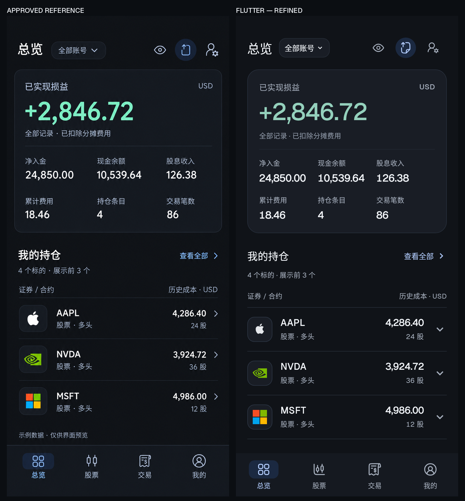
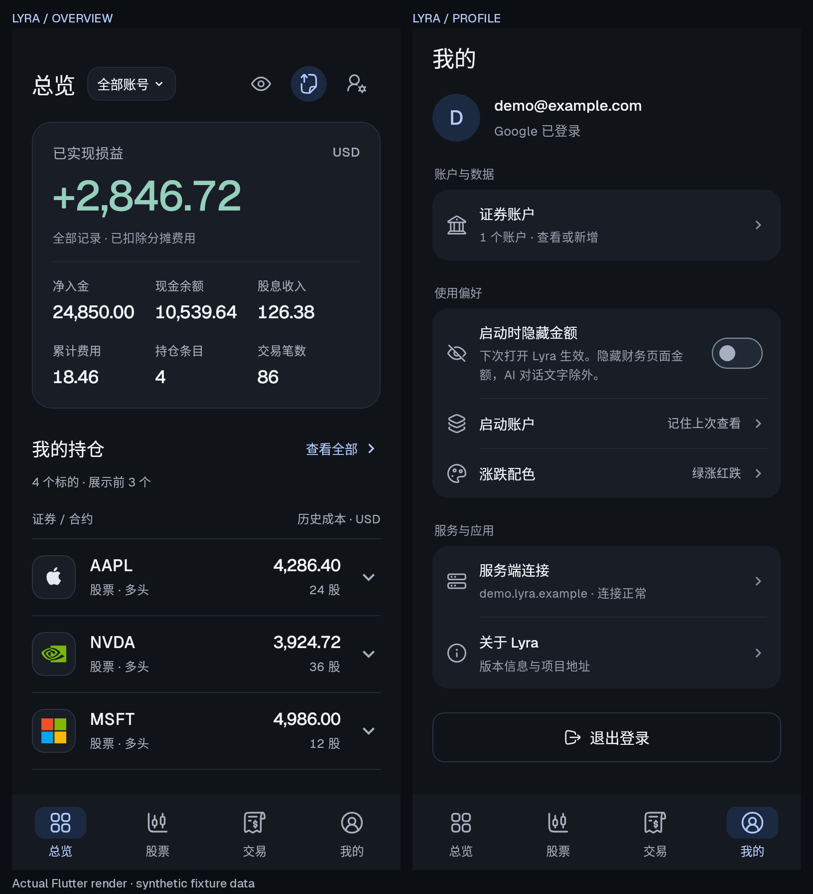
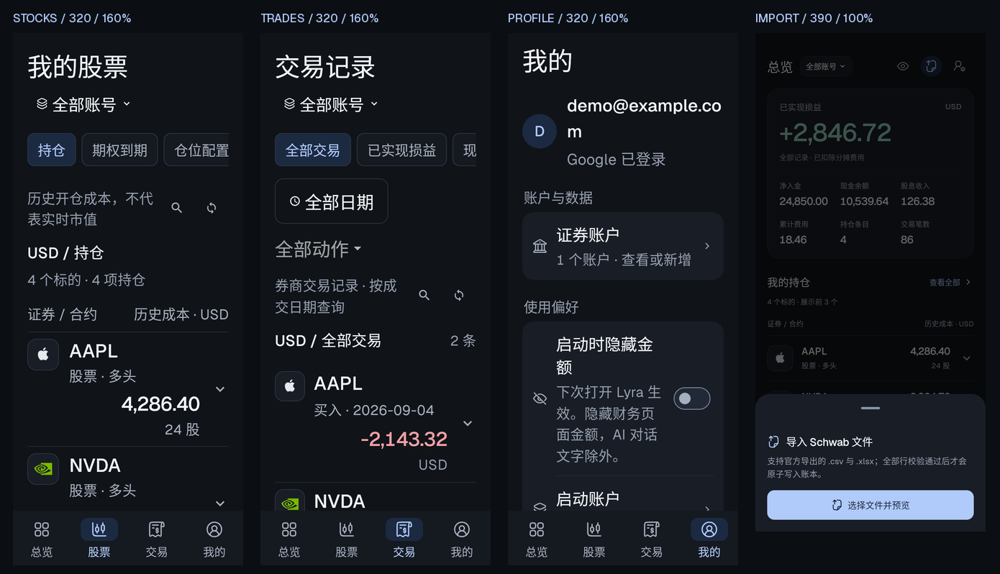

# Lyra 石墨灰 / 冰蓝界面验收

日期：2026-10-11。应用版本：1.0.0（versionCode 3）。

**验收结论：通过。** 最后一次截图检查没有未解决的 P0 / P1 / P2；小屏标题和导入取消提示的修正已由第二位检查者重新目视确认。剩余 P3 差异与原生设备验收边界见下文。

## 设计依据与实现范围

用户选择的是 Genkit 首页 **Ticket assistant 手机演示**的深色界面方向，随后批准了 Lyra 总览精修稿。唯一实施依据是 [已批准的精修图](docs/plans/assets/graphite-20261011-overview-reference.png)，没有以较早的浅色稿或 Genkit Developer UI 作为目标。

本轮直接修改现有 Flutter 应用：共享主题、总览、四项导航、股票与交易列表、报告、我的与偏好、登录、账户创建、导入和助手界面，以及 Android 启动背景与系统栏。交互与持久化继续使用已有实现。

## 实际画面对照



左侧为精修稿，右侧为真实 Flutter 组件渲染。两侧统一到 390 × 844 逻辑视口、2 倍像素密度，保持完整画面；对照图外的英文标签仅用于验收。先并排检查，再针对差异修改并重新捕获，而非仅检查源码或单独观看两张图片。



### 主要视觉规则

| 项目 | 实现与验收 |
| --- | --- |
| 画布与层次 | `#101318` 画布，`#191D25` 卡片，细边框；取消旧浅绿渐变，控件与弹层统一暗色 |
| 文字与动作 | 正文 `#F1F4F8`，次级文字 `#A6AFBD`，动作 `#B0CAFA`；浅蓝实心按钮使用深色 `onAccent` 前景 |
| 主数据 | 总览 42px 主盈亏、18px 辅助金额，增加正盈亏的 `+`；零值、负数、极小数的舍入提示保持原有准确含义 |
| 持仓 | 标的与历史成本同一主行，类型 / 方向与数量同一次行；每币种独立表头，保留原始金额提示及展开明细 |
| 密度 | 常规持仓行以 74px 最小高度排版，390 视口完整展示前三项；放大字体时允许自然增高与金额分行 |
| 导航与图标 | 四项导航保留，小型冰蓝选中底块；主操作采用统一描边图标，证券品牌继续使用已有 PNG |
| 设置 | 紧凑身份区、深灰分组、组内分隔线；当前设置值优先同排，窄屏允许换行 |

### 有意保留的实现差异

- 精修图的轻微雾化和光晕没有进入产品；实际采用平面填色，保证文字和数据清楚。
- 精修图的“示例数据 · 仅供界面预览”是设计注释，不写入生产界面。截图使用测试夹具；安装后的应用只读取登录账户的服务端数据。
- 明细继续在当前列表展开，因此保留原生向下展开箭头；没有改成跳转到新详情页。
- 页面使用统一 20px 边距，导航高度与系统安全区域遵循实际设备。与生成图边距、字号轮廓和底部留白的细小差异列为 P3。
- AAPL 仅在 Flutter 渲染时将已核实的灰阶白底 PNG 映射为浅色标识，保留原轮廓；彩色品牌图保持原色，必要时使用浅色底托。
- 收益走势、报告和 AI 次级入口仍在总览下方，可继续滚动访问。

## 发现与修正

| 严重度 | 发现 | 处理 |
| --- | --- | --- |
| P2 | 第一轮主金额偏小，未显式指定颜色的标题继承了次级灰色 | 主金额 36 → 42px；正文默认使用主文字色，辅助说明保留显式次级色 |
| P2 | 默认持仓行叠加上下内边距，第三条记录被挤出首屏 | 去掉重复内边距，保留 74px 最小高度及大字自然增长；重新截图后三条完整可见 |
| P2 | 窄屏大字的交易金额仍被双列宽度压小 | 与持仓一样依据宽度和实际文字缩放转为整行金额；精度与原始值提示不变 |
| P2 | 320px / 1.6 倍字体的页面标题与分组标题出现单字孤行 | 标题和账户范围分行；记录分组头使用可换行布局，标题优先保留完整宽度 |
| P2 | 导入弹层缺少可见的关闭提示 | 补与其他弹层一致的拖动把手，保留系统返回及遮罩取消路径 |
| P3 | 320px / 1.6 倍字体中长邮箱和部分说明换行不够均匀 | 可完整读取、无重叠；保留字号与滚动，不为强行单行而截掉内容 |

金额眼睛图标同步调整为当前状态：金额可见时显示睁眼，隐藏时显示划线眼睛；按钮提示仍清楚说明下一步动作。

## 检查方法与结果

`test/design_capture_test.dart` 使用实际 `LyraApp`、页面与控件，通过平台文字缩放设置大字模式，并在 MaterialApp 内断言实际缩放值。截图来自 `RenderRepaintBoundary`，每次捕获前等待品牌图解码，并检查布局异常。

| 场景 | 覆盖内容 |
| --- | --- |
| 390 × 844，1 倍文字 | 总览、股票、交易、我的、涨跌配色、连接管理、导入、隐藏金额总览 |
| 320 × 740，1.6 倍文字 | 总览、股票、交易、我的 |
| 390 × 844，未登录 | 总览与我的，包括保存地址与 Google 登录入口 |
| 1440 × 960 | 总览、宽屏导航、持仓与收益走势分栏 |



字体使用项目中的 Geist / Geist Mono；截图额外加载 Noto CJK 作为中文字体，不增加生产包字体资产。凭据、邮箱、账户和 HTTP 响应均为测试夹具，不连接真实 Google、模型或投资账户。仅截图夹具将现金余额设为精修稿的 `10539.64`，共享业务夹具与生产计算没有改动。

已执行的功能回归为 **162 项通过**。金额隐私检查包括屏幕文本、原始值 Tooltip、已展开提示、读屏语义、期权价格和图表；正负配色、启动账户恢复、登录、取消、建账户、导入、连接与保存失败继续通过。新的图片捕获测试默认跳过，需要显式参数启动，不增加普通测试对系统中文字体的依赖。

本轮静态分析为零问题。最后一轮图片捕获 **4 个场景通过，输出 15 张 PNG**；320 大字标题与导入把手已重新目视确认。APK 元数据及签名结果汇总在 [实现进度](docs/progress.md)。视觉验收依据为本机 Flutter 渲染及控件交互；尚未进行此版本的 Android 真机安装、冷启动、系统浏览器 OAuth 或真实模型联调。

## 复现

在 `apps/mobile` 目录使用项目 Flutter 版本：

```bash
flutter analyze --no-pub
flutter test --no-pub --reporter expanded --timeout 60s
flutter test test/design_capture_test.dart --no-pub --reporter expanded \
  --dart-define=LYRA_REVIEW_DIR=/absolute/review/output \
  --dart-define=LYRA_CJK_FONT=/absolute/NotoSansCJKsc-Regular.otf \
  --dart-define=LYRA_FLUTTER_ROOT=/absolute/flutter
flutter build apk --debug --no-pub
```

完整功能测试与图片捕获须分别执行。图片测试输出 15 张 PNG，另将批准稿与总览截图等比例归一化并排，生成本文的对照图。
