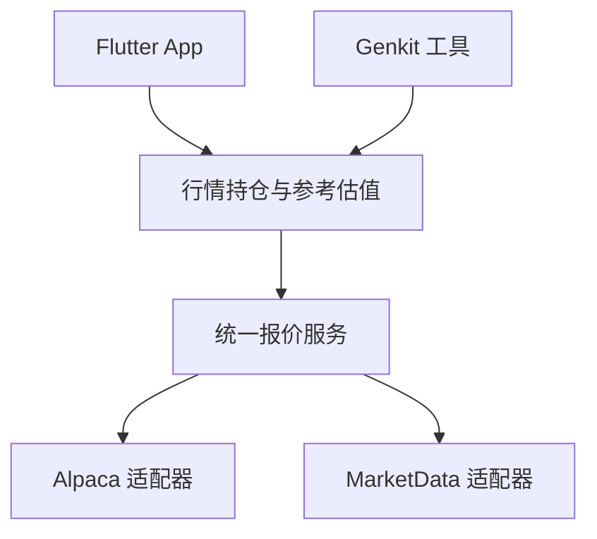

# 行情接入与换源

Lyra 将行情提供方放在服务端适配器边界内。App 和 Genkit 读取同一份标准报价与参考估值；换源时，现有持仓成本、FIFO、已实现盈亏和页面金额计算不会跟着供应商 API 改写。

当前实现支持 **USD 账户内可精确识别的美国股票和标准美股期权**，以历史或延迟行情作为参考。默认关闭远程行情；已实现 Alpaca、MarketData 两个适配器，真实账户凭据与权限尚未联调。

## 1. 层次和入口



| 层 | 责任 | 主要文件 |
| --- | --- | --- |
| 领域契约 | 标准证券身份、报价、时点、来源、缺失状态 | `server/src/domain/market-data/types.ts` |
| 选价规则 | 有效买卖中间价 → 最近成交价 → 区间收盘价 | `server/src/domain/market-data/reference-price.ts` |
| 报价服务 | 路由、缓存、并发合并、请求预算、超时和备用源 | `server/src/application/market-data-service.ts` |
| 持仓估值 | 账户授权、证券匹配、多空、合约乘数、币种分组 | `server/src/application/market-position-view.ts` |
| 供应商适配 | 鉴权、端点、供应商代码、字段及错误归一化 | `server/src/infrastructure/market-data/*-provider.ts` |
| 配置组装 | 注册具体供应商，校验配置并设置缓存和预算 | `server/src/infrastructure/market-data/market-data-runtime.ts` |
| 移动端 | 读取标准结果、匹配当前持仓、展示时间与隐私状态 | `apps/mobile/lib/features/market/` |

App 使用已鉴权的 `GET /v1/market/positions?scope=all`，可带 `underlying` 筛选；单账户范围沿用现有 `scope` 规则。协议头仍为 `X-Lyra-Protocol-Version: 2`。响应复用账本的 `metadata` / `data` 信封，包含账户范围和 `ledgerVersion`。

Genkit 的 `market-positions` 工具通过同一估值层执行，只公开可选的 `underlying` 参数。供应商、任意 URL、账户权限和密钥均不能由模型参数覆盖。工具标记为外部只读；调用继续接受既有范围及账本版本校验，并保存工具审计。

## 2. 稳定的证券身份与报价

领域内不使用供应商的期权代码作为唯一身份。例如：

```text
US:stock:AMD
US:option:AMD:2026-10-16:C:150
```

期权身份包括标的、到期日、C/P、行权价、市场、币种和乘数。适配器负责转换为自己的 OCC 等代码；估值入口先核对完整 Schwab 合约文本与各字段，不能仅凭标的将股票、Call、Put 或不同到期日关联到同一报价。

核心接口：

```ts
interface MarketDataProvider {
  readonly id: string;
  readonly assetTypes: readonly ("stock" | "option")[];
  fetchQuote(
    instrument: MarketInstrument,
    context: { now: Date; signal: AbortSignal },
  ): Promise<ProviderQuoteResult>;
}

interface MarketDataReader {
  getQuote(instrument: MarketInstrument): Promise<MarketQuoteLookup>;
  status(): MarketDataStatus;
}
```

每个标准报价保留 `providerId`、`feed`、`currency`，以及可为空的 `bid`、`ask`、`last`、`close`。每个价格点都是 `{ value: string, asOf: string }`，金额使用十进制字符串，时间归一到含时区的 ISO 时间。服务层校验身份、币种、时间和数值，并剥离供应商额外字段。

时间字段有不同含义：

- 价格点的 `asOf` 是源提供的行情快照时点；供应商只有快照更新时间时，不能将它解读为逐笔成交时间。Alpaca 一分钟 K 线的 `close.asOf` 使用该分钟结束时间。
- `quote.fetchedAt` 记录本次向供应商发起读取的服务端时间。缓存命中时保留原读取时间。
- 响应 `metadata.asOf` / `metadata.fetchedAt` 属于账本读取与响应信封，不替代价格时点。页面单独展示行情时间与读取时间。
- `timing.kind` 表示延迟或历史日终类别，`delayMinutes` 表示所请求模式的延迟下限。实际价格可能更旧，始终以 `asOf` 为准。内部 `end_of_day` 是通用数据类别，不代表向 MarketData 请求付费的 `mode=eod`。

`MarketQuoteLookup` 返回 `available`、`stale` 或 `unavailable`，并独立提供 `referencePrice`、`issue` 和 `cached`。错误为固定枚举，例如 `not_configured`、`no_data`、`rate_limited`、`credentials_rejected`、`timeout`；原始供应商错误正文、请求头和凭据不会返回给 App 或模型。

## 3. 参考价与估值口径

所有供应商共用以下选价顺序：

1. 同一快照时点、有数值且未交叉的买卖价，取 `(bid + ask) / 2`；允许零买价，但卖价必须大于零。
2. 无有效中间价时，使用大于零的 `last`。
3. 再尝试大于零的 `close`，并标明“区间收盘价”。

结果带 `basis: mid | last | close`。不会把缺失报价补成零，也不直接使用供应商不透明的 `mark` / `mid` 算法。计算使用局部 64 位有效数字的十进制上下文，避免金额转成二进制浮点数。

当前持仓的 `cost` 是历史价格乘数量，期权尚未乘合约乘数。估值层按以下公式计算，`sign` 对多头为 `+1`、空头为 `-1`，股票乘数为 `1`，标准期权为 `100`：

```text
参考市值 = sign × quantity × referencePrice × multiplier
未实现盈亏 = sign × (quantity × referencePrice − cost) × multiplier
```

例如，买入一张价格为 2 的标准期权，参考价为 4，则参考市值为 400、未实现盈亏为 200；相同开仓价与参考价的空头，参考市值为 −400、未实现盈亏为 −200。两者均不含费用。

这是**当前未平持仓按各自报价时点的参考估值**。它没有把持仓还原到过去某日，没有加入现金，也没有将所有证券的价格对齐为同一时刻；不能作为历史组合净值、当日盈亏或可成交价格。

响应按币种分组，给出 `asOfFrom` / `asOfTo`。某组只要有缺失、过期或不支持的持仓，`complete` 就为 `false`，该组市值和盈亏合计保持 `null`；已有旧报价可以显示行级参考值，并明确标为过期。`pricedCount` / `pricedPositions` 包含这些有旧参考值的行，判断可完整汇总时还必须检查 `complete`。

第一版没有汇率换算。账本没有独立的证券计价币种信息，因此非 USD 账户返回 `currency_unsupported`。无法精确映射的调整合约、非标准交割、分数期权合约数量等返回 `unsupported_instrument`，不会猜测乘数。

## 4. 配置与换源

开发环境编辑 `server/.env`，Compose 部署编辑 `deploy/server.env`。以下只展示行情相关配置；Google 登录等既有必需配置仍须保留。

### 使用一个提供方

股票和期权都选 MarketData，使用账户允许的历史模式：

```dotenv
LYRA_MARKET_STOCK_PROVIDERS=marketdata
LYRA_MARKET_OPTION_PROVIDERS=marketdata
LYRA_MARKETDATA_API_TOKEN=填写真实服务端token
LYRA_MARKETDATA_MODE=historical
LYRA_MARKETDATA_DAILY_REQUEST_LIMIT=80
LYRA_MARKET_TIMEOUT_MS=8000
```

适配器会显式传 `mode=historical`；即使账户以后升级，也不会因付费账户默认模式改变而悄悄请求实时数据。历史数据的可用时点由提供方及端点决定，不是固定“昨天”或固定延迟 24 小时。尤其期权在周末或节假日可能仍返回更早交易日的数据，页面保留实际时间。

如账户具有延迟模式权限，可设 `LYRA_MARKETDATA_MODE=delayed`，请求随之改为 `mode=delayed`，声明至少延迟 15 分钟。该模式需要相应付费权限；Lyra 不会因配置模式而取得额外授权。

### 按资产类型选源

股票使用 Alpaca，期权使用 MarketData：

```dotenv
LYRA_MARKET_STOCK_PROVIDERS=alpaca
LYRA_MARKET_OPTION_PROVIDERS=marketdata
LYRA_ALPACA_API_KEY=填写真实服务端key
LYRA_ALPACA_SECRET_KEY=填写真实服务端secret
LYRA_MARKETDATA_API_TOKEN=填写真实服务端token
LYRA_MARKETDATA_MODE=historical
LYRA_MARKETDATA_DAILY_REQUEST_LIMIT=80
```

若希望某一类证券在主源失败或缺价时尝试另一个已配置的源，可显式写顺序：

```dotenv
LYRA_MARKET_STOCK_PROVIDERS=alpaca,marketdata
LYRA_MARKET_OPTION_PROVIDERS=marketdata,alpaca
```

备用源可能有不同的报价字段和时点，因此每行保留实际来源与选价依据。只有列入配置且凭据完整的源才会参与请求。配置为 `none` 可单独关闭某类资产；仅填写凭据不会自动启用行情。

改配置后按[部署指南](deployment.md)先运行离线预检，再重启服务。已实现的两个源之间切换不需要修改 Flutter、Genkit 工具或估值公式。初始化会拒绝未知 / 重复来源、`none` 与提供方混用、缺少凭据以及无效模式 / 请求上限；配置错误在数据库迁移前被发现。

## 5. 两个适配器的实际行为

| 提供方 | 股票 | 期权 | 说明 |
| --- | --- | --- | --- |
| Alpaca | 历史 SIP 买卖报价，读取不晚于请求时点减 16 分钟的最新一条 | 历史 OPRA 一分钟 K 线，读取已结束且不晚于同一截止时点的收盘价 | 回看最多 7 天。期权没有该接口提供的 bid / ask，保持空值；没有使用改写价格的 indicative feed |
| MarketData | 单证券报价中的 bid / ask / last | 单合约报价中的 bid / ask / last | 显式请求 historical 或 delayed；当前只读取该模式下最近可得的快照，不传 `date` / `from` / `to`，也不提供期权链或 Greeks |

适配器使用固定 HTTPS 端点，密钥仅放在请求头；只在单一符号、列结构、价格和时间均有效时归一化。MarketData 接受形状一致的 HTTP 200 / 203 成功响应。HTTP 层限制响应体为 64 KiB，拒绝重定向，支持取消和完整响应体读取超时，不自动重试。

这些是已落盘的请求与解析规则。具体账号能否取得 SIP / OPRA 或某种模式的数据，还需用自己的凭据验证；没有真实 Key 时，不将单元测试视为供应商验收。

## 6. 缓存、请求预算与失败行为

| 策略 | 当前默认值 |
| --- | --- |
| Alpaca 缓存 TTL | 15 分钟 |
| MarketData historical 缓存 TTL | 24 小时 |
| MarketData delayed 缓存 TTL | 15 分钟 |
| Alpaca 本地请求上限 | 每分钟 120 次 |
| MarketData 本地请求上限 | 每分钟 30 次、滚动 24 小时 80 次；后者可配置 |
| 同时外部请求 | 全服务最多 4 个 |
| 单请求服务超时 | 8 秒，可配置 1–15 秒；适配器 HTTP 层另有 10 秒上限 |
| 行情缓存容量 | 最多 1,000 项，按写入顺序淘汰最早项 |
| 报价年龄上限 | 超过 7 天标为 `stale` |

缓存键包含提供方和完整证券身份。同一证券在多个账户或并发请求中只需一份行情读取；只缓存公开行情，账户持仓、授权结果和估值不进入报价缓存。返回和缓存边界会复制对象，避免适配器或调用方修改其他请求看到的价格。

**刷新按需发生**：读取时命中 TTL 就复用，否则尝试更新。没有后台定时任务，也不保证每天某一时刻更新。24 小时 TTL 可能推迟看到供应商刚更新的日终数据。

限流后冷却 15 分钟，凭据拒绝后冷却 5 分钟，一般故障冷却 1 分钟；单证券无数据或不支持的结果短期缓存，不阻断该源的其他证券。刷新失败时可保留已有报价并标为 `stale`；有显式备用源时优先尝试取得可用报价。全失败或未配置时只影响行情面板，账本成本和既有分析仍可读取。

缓存、并发合并和预算都在当前进程内，重启后清空。这里的每日本地计数是请求数，不是供应商 credits 余额，也不能约束同一 Key 在其他应用里的消费；服务商自身限额始终有效。

## 7. 增加第三个提供方

1. 在基础设施目录实现 `MarketDataProvider`，完成标准证券到供应商标识的转换、字段 / 单位 / 时间归一化，并将异常映射为固定错误枚举。
2. 在 `market-data-runtime.ts` 注册工厂、配置名称、凭据校验、支持的资产类型与缓存 / 请求预算；配置预检和两个 env 模板同步更新。
3. 使用受控 HTTP fixture 验证完整合约匹配、价格单位、时间、缺字段、限流、权限失败及取消；通过公共报价服务验证换源与缓存隔离。
4. 用部署账户做一次真实请求验收，再将该源加入所需资产路由。

现有报价结构和资产能力能表达新源时，其余业务层无需修改。未来若增加其他市场、外汇或非标准期权乘数，需要明确扩展领域契约；不能把新语义塞入 `feed` 文案或伪装成现有资产。

## 8. 验证与当前边界

服务端测试覆盖适配器协议、来源配置、缓存与预算、故障回退、精度、完整证券身份、真实 DuckDB 持仓估值、路由鉴权以及账本版本门禁。Flutter 测试覆盖完整合约匹配、账户 / 会话切换、恢复启动范围、缺价 / 过期、金额隐私及窄屏大字体。测试使用合成行情，没有真实凭据、真实行情请求或付费订阅操作。

最新全量结果见[实现进度](progress.md)。本轮未重新构建 Android APK；此前交付的深色界面 APK 不包含新增行情面板。实际供应商权限、VPS 和真机联调仍需部署后验收。

## 官方协议参考

实现核对日期：2026-10-11。提供方的计划、权限和数据可用性可能变化，部署时以自己的账户和当前官方文档为准。

- [Alpaca Market Data FAQ](https://docs.alpaca.markets/us/docs/market-data-faq)
- [Alpaca 历史股票报价](https://docs.alpaca.markets/us/v1.4.2/reference/stockquotesingle-1)
- [Alpaca 历史期权 K 线](https://docs.alpaca.markets/us/reference/optionbars)
- [Alpaca 官方说明：历史期权 K 线数据源](https://forum.alpaca.markets/t/data-source-for-option-historical-bars/17704)
- [MarketData 股票报价](https://www.marketdata.app/docs/api/stocks/quotes/)
- [MarketData 期权报价](https://www.marketdata.app/docs/api/options/quotes/)
- [MarketData Data Mode](https://www.marketdata.app/docs/api/universal-parameters/mode/)
- [MarketData Data Freshness](https://www.marketdata.app/docs/account/data-freshness/)
