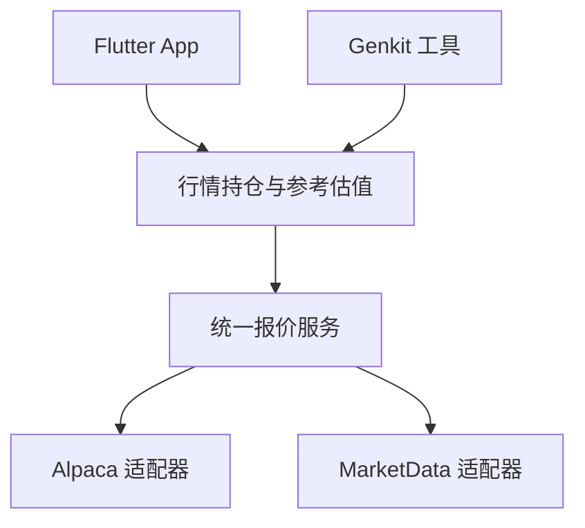

# 行情接入与换源

在 **「我的 → 行情与估值」**，股票和期权可以分别选择主来源、备用来源或关闭。每次选择自动提交，服务端确认后，新的行情请求立即使用所选来源；设置持久化到服务端，**按用户保存**：该用户的全部账户、设备和 Lyra 助手共用，各用户互不影响，重启后恢复。

Lyra 将行情提供方放在服务端适配器边界内。App 和 Genkit 读取同一份标准报价与参考估值；换源时，现有持仓成本、FIFO、已实现盈亏和页面金额计算不会跟着供应商 API 改写。

当前实现支持 **USD 账户内可精确识别的美国股票和标准美股期权**，以历史或延迟行情作为参考。默认关闭远程行情；已实现 Alpaca、MarketData 两个适配器，真实账户凭据与权限尚未联调。

## 1. 层次和入口



| 层 | 责任 | 主要文件（Python/FastAPI，见[服务端部署](deployment.md)） |
| --- | --- | --- |
| 领域契约 | 标准证券身份、报价、时点、来源、缺失状态 | `server/src/lyra/domain/market_data/types.py` |
| 设置契约 | 来源目录、主备顺序、设置版本与当前生效来源 | `server/src/lyra/domain/market_data/settings.py` |
| 选价规则 | 有效买卖中间价 → 最近成交价 → 区间收盘价 | `server/src/lyra/domain/market_data/reference_price.py` |
| 报价服务 | 路由、缓存、并发合并、请求预算、超时和备用源 | `server/src/lyra/application/market_data_service.py`、`server/src/lyra/application/market_budget.py` |
| 持仓估值 | 账户授权、证券匹配、多空、合约乘数、币种分组 | `server/src/lyra/domain/market_data/valuation.py` |
| 供应商适配 | 鉴权、端点、供应商代码、字段及错误归一化 | `server/src/lyra/infrastructure/market_data/*_provider.py` |
| 配置组装 | 注册具体供应商，校验配置并设置缓存和预算 | `server/src/lyra/infrastructure/market_data/runtime.py`、`config.py` |
| 设置保存 | 设备鉴权、版本冲突、DuckDB 持久化与热切换 | `server/src/lyra/api/market_routes.py`、`server/src/lyra/infrastructure/db/market_settings_repository.py` |
| 移动端 | 读取标准结果、匹配当前持仓、展示时间与隐私状态 | `apps/mobile/lib/features/market/` |

App 使用已鉴权的 `GET /v1/market/positions?scope=all`，可带 `underlying` 筛选；单账户范围沿用现有 `scope` 规则。重复或非字符串的查询参数返回 `400 / INVALID_ARGUMENT`，不会静默忽略筛选条件后返回未过滤结果。协议头仍为 `X-Lyra-Protocol-Version: 2`。响应复用账本的 `metadata` / `data` 信封，包含账户范围和 `ledgerVersion`，`data.marketData.settingsRevision` 标明本次估值使用的来源设置版本。

Genkit 的 `market-positions` 工具通过同一估值层执行，只公开可选的 `underlying` 参数。供应商、任意 URL、账户权限和密钥均不能由模型参数覆盖。工具标记为外部只读；调用继续接受既有范围及账本版本校验，并保存工具审计。

## 2. 稳定的证券身份与报价

领域内不使用供应商的期权代码作为唯一身份。例如：

```text
US:stock:AMD
US:option:AMD:2026-10-16:C:150
```

期权身份包括标的、到期日、C/P、行权价、市场、币种和乘数。适配器负责转换为自己的 OCC 等代码；估值入口先核对完整 Schwab 合约文本与各字段，不能仅凭标的将股票、Call、Put 或不同到期日关联到同一报价。

核心接口：

```ts
interface MarketDataProvider {
  readonly id: string;
  readonly assetTypes: readonly ("stock" | "option")[];
  fetchQuote(
    instrument: MarketInstrument,
    context: { now: Date; signal: AbortSignal },
  ): Promise<ProviderQuoteResult>;
}

interface MarketDataReader {
  getQuote(instrument: MarketInstrument): Promise<MarketQuoteLookup>;
  status(): MarketDataStatus;
  snapshot?(): MarketDataReader;
}
```

每个标准报价保留 `providerId`、`feed`、`currency`，以及可为空的 `bid`、`ask`、`last`、`close`。每个价格点都是 `{ value: string, asOf: string }`，金额使用十进制字符串，时间归一到含时区的 ISO 时间。服务层校验身份、币种、时间和数值，并剥离供应商额外字段。

时间字段有不同含义：

- 价格点的 `asOf` 是源提供的行情快照时点；供应商只有快照更新时间时，不能将它解读为逐笔成交时间。Alpaca 一分钟 K 线的 `close.asOf` 使用该分钟结束时间。
- `quote.fetchedAt` 记录本次向供应商发起读取的服务端时间。缓存命中时保留原读取时间。
- 响应 `metadata.asOf` / `metadata.fetchedAt` 属于账本读取与响应信封，不替代价格时点。页面单独展示行情时间与读取时间。
- `timing.kind` 表示延迟或历史日终类别，`delayMinutes` 表示所请求模式的延迟下限。实际价格可能更旧，始终以 `asOf` 为准。内部 `end_of_day` 是通用数据类别，不代表向 MarketData 请求付费的 `mode=eod`。

`MarketQuoteLookup` 返回 `available`、`stale` 或 `unavailable`，并独立提供 `referencePrice`、`issue` 和 `cached`。错误为固定枚举，例如 `not_configured`、`no_data`、`rate_limited`、`credentials_rejected`、`timeout`；原始供应商错误正文、请求头和凭据不会返回给 App 或模型。

## 3. 参考价与估值口径

所有供应商共用以下选价顺序：

1. 同一快照时点、卖价不低于买价且两者都大于零的买卖价，取 `(bid + ask) / 2`；零买价按缺失处理，不产生中间价。
2. 无有效中间价时，使用大于零的 `last`。
3. 再尝试大于零的 `close`，并标明“区间收盘价”。

结果带 `basis: mid | last | close`。不会把缺失报价补成零，也不直接使用供应商不透明的 `mark` / `mid` 算法。计算使用局部 64 位有效数字的十进制上下文，避免金额转成二进制浮点数。

当前持仓的 `cost` 是历史价格乘数量，期权尚未乘合约乘数。估值层按以下公式计算，`sign` 对多头为 `+1`、空头为 `-1`，股票乘数为 `1`，标准期权为 `100`：

```text
参考市值 = sign × quantity × referencePrice × multiplier
未实现盈亏 = sign × (quantity × referencePrice − cost) × multiplier
```

例如，买入一张价格为 2 的标准期权，参考价为 4，则参考市值为 400、未实现盈亏为 200；相同开仓价与参考价的空头，参考市值为 −400、未实现盈亏为 −200。两者均不含费用。

这是**当前未平持仓按各自报价时点的参考估值**。它没有把持仓还原到过去某日，没有加入现金，也没有将所有证券的价格对齐为同一时刻；不能作为历史组合净值、当日盈亏或可成交价格。

响应按币种分组，给出 `asOfFrom` / `asOfTo`。某组只要有缺失、过期或不支持的持仓，`complete` 就为 `false`，该组市值和盈亏合计保持 `null`；已有旧报价可以显示行级参考值，并明确标为过期。`pricedCount` / `pricedPositions` 包含这些有旧参考值的行，判断可完整汇总时还必须检查 `complete`。

第一版没有汇率换算。账本没有独立的证券计价币种信息，因此非 USD 账户返回 `currency_unsupported`。无法精确映射的调整合约、非标准交割、分数期权合约数量等返回 `unsupported_instrument`，不会猜测乘数。

## 4. 在界面选择来源

### 日常操作

1. 登录 App，打开「我的 → 行情与估值」。来源列表由服务端返回，包含支持的资产类型、凭据是否配置，以及历史或延迟模式说明。
2. 分别设置「股票」和「期权」的「主来源」。需要回退时，再选择一个不同的「备用来源」；主来源选「关闭」并得到服务端确认后，该资产不再发起新的行情读取。
3. 每次选择都会自动发送设置请求，无需点击保存。等待确认时显示「正在切换」并暂时禁用来源控件；确认后刷新参考估值。若请求失败，界面恢复最后已确认的选择并提示重试。

例如，股票主来源选 Alpaca、备用选 MarketData，期权主来源选 MarketData、备用选「不使用备用」。也可以两类都使用同一个来源，或分别关闭。备用源只在主来源无法提供可用报价时尝试；实际来源与选价依据仍显示在每一项行情明细中。

选择保存在服务端，作用于**该用户**的全部证券账户与设备。其他设备下一次读取设置或行情时会获得新的选择与版本；服务重启后优先恢复已保存设置。切源不需要重启服务，也不会修改已保存的账本交易和历史工具结果。关闭设置面板后，同一会话中已提交的请求仍能完成；退出登录或切换身份后，旧结果不会写回新的会话。

**未配置的来源会显示但不可选。** 若已保存来源的凭据后来移除、资产支持变化，或者适配器已被移除，原选择仍保留，并在界面提示不可用。实际请求会过滤这些项，用户可以改选其他来源或关闭；不会擅自选择没有保存过的新来源。

### 服务器准备可选来源

开发环境使用 `server/.env`，Compose 部署使用 `deploy/server.env`。服务器负责凭据、MarketData 数据模式、预算和超时；日常主备选择由 App 自动提交并持久化。下面示例注册两个可选来源，同时保持尚未保存时的行情默认关闭；只填计划使用的来源凭据即可。

```dotenv
LYRA_MARKET_STOCK_PROVIDERS=none
LYRA_MARKET_OPTION_PROVIDERS=none
LYRA_ALPACA_API_KEY=填写真实服务端key
LYRA_ALPACA_SECRET_KEY=填写真实服务端secret
LYRA_MARKETDATA_API_TOKEN=填写真实服务端token
LYRA_MARKETDATA_MODE=historical
LYRA_MARKETDATA_DAILY_REQUEST_LIMIT=80
LYRA_MARKET_TIMEOUT_MS=8000
```

完整凭据使对应来源在服务端注册、在 App 中变为可选；**填写 Key 本身不会启用远程行情**。这些字段不接受 App 或模型覆盖，密钥不会出现在来源目录、设置响应或 APK 中。新增或修改凭据、模式、预算后，重启服务（配置在启动时校验，见[部署指南](deployment.md)），再回到界面选择。

`LYRA_MARKET_STOCK_PROVIDERS` 与 `LYRA_MARKET_OPTION_PROVIDERS` 只在数据库还没有保存记录时提供启动默认值，可填 `none`、`alpaca`、`marketdata` 或逗号分隔的主备顺序。模板保留 `none`，便于通过 App 管理。已有持久记录时，环境变量中的来源顺序不会覆盖用户保存的选择。环境默认值仍须在启动时通过校验；若旧配置里显式指定了某个源，移除其 Key 时也应将对应默认值改回 `none`，避免留下不完整的启动配置。

MarketData 默认显式传 `mode=historical`；即使账户以后升级，也不会因付费账户默认模式改变而悄悄请求实时数据。历史数据的可用时点由提供方及端点决定，不是固定“昨天”或固定延迟 24 小时。尤其期权在周末或节假日可能仍返回更早交易日的数据，页面保留实际时间。

如账户具有延迟模式权限，可设 `LYRA_MARKETDATA_MODE=delayed`，请求随之改为 `mode=delayed`，声明至少延迟 15 分钟。该模式需要相应权限；Lyra 不会因配置模式而取得额外授权。启动时的校验只看配置形状、已选择默认源的凭据完整性及模式 / 请求上限，不验证供应商账户权限或剩余额度。

### 设置 API 与版本

`GET /v1/market/settings` 和 `PUT /v1/market/settings` 均要求协议 3 与有效设备 Bearer token，响应使用 `Cache-Control: no-store`。这是**当前用户自己的**来源设置，各用户独立保存、各自的 revision 互不影响；不接收账户范围、供应商 URL 或密钥，也没有对应的 Genkit 写工具。供应商凭据、公开报价缓存与供应商预算仍是部署级共享，不随用户划分。

GET 直接返回 `MarketSettingsView`：

| 字段 | 含义 |
| --- | --- |
| `revision` | 当前已保存设置版本；尚无记录时为 `0` |
| `routes.stock` / `routes.option` | 用户保存的有序来源 ID；最多主、备各一个，`[]` 表示关闭 |
| `effectiveRoutes` | 按当前凭据和资产支持情况过滤后的实际来源顺序 |
| `providers` | 服务端来源目录：`id`、`displayName`、`assetTypes`、`configured`、`timing`、`cacheTtlSeconds`；没有密钥，`configured` 也不保证外部服务健康 |
| `updatedAt` | 最近保存变化的时间；尚无记录时为 `null` |

App 每次改变来源选择都会自动调用 PUT，严格请求示例：

```json
{
  "expectedRevision": 3,
  "routes": {
    "stock": ["alpaca", "marketdata"],
    "option": ["marketdata"]
  }
}
```

写入成功返回完整的 `MarketSettingsView`。服务端在共享写队列中重新验证设备凭据、读取当前版本，事务提交成功后才切换运行时路由。App 在请求期间限制重复操作，收到确认后刷新行情。

新增来源，或将来源移动到另一资产类型、另一主备位置时，都要求它仍在目录中、凭据已配置且支持目标资产。为支持逐项自动提交，某个失效 ID 如果在**同一资产、同一索引**保持原样，可以随其他字段的变更一起保留；`effectiveRoutes` 仍会过滤它，因此保留原位置不会重新启用失效来源。例如，修复期权来源时，不要求同时修复股票来源。重复、超出两项、未知字段或不允许的新选来源返回 `400 / INVALID_ARGUMENT`，新选来源缺凭据返回 `400 / MARKET_PROVIDER_NOT_CONFIGURED`；这类错误需要重新加载设置后再选择。

普通网络错误可能发生在服务端已经提交、但响应未送达之后。App 提示「未能确认切换，界面已恢复原选择。请重试。」；这里恢复的是最后已确认的**界面选择**，不能据此判断服务端已经回滚。点击「重试切换」会使用原目标和原 `expectedRevision` 再次提交：若首次请求已经成功且服务端仍是该目标，幂等分支会返回当前结果；若其他设备已改为不同目标，则进入版本冲突处理。

若 `expectedRevision` 与当前版本不同且目标与现值不同，返回 `409 / MARKET_SETTINGS_CHANGED`。App 恢复最后已确认的界面选择，并提示重新加载后再选择，不会自动重试覆盖其他设备的更改。若目标已经与现值完全相同，则作为幂等重试返回当前结果，不增加版本，也不会重复应用路由。尚无保存记录且选择未改变时，继续使用环境默认值，不创建持久记录。设置写入 schema 14 的 `market_source_settings`，随数据库备份，且不增加金融账本的 `ledgerVersion`。

首次读取设置若返回 `404`，界面提示服务端版本较旧；先更新服务端，再重新加载来源后选择，不把缺失的设置接口当作一次成功切换。

每次持仓估值固定一份来源快照，结果中的 `data.marketData.settingsRevision` 对应整次读取。读取途中切源不会导致同一份结果混用不同设置版本。App 在自动提交得到确认后使旧请求失效；低于已知设置版本的迟到响应不会覆盖新结果。已开始的旧版本服务端请求仍可能完成，其结果保留自身的来源版本。

## 5. 两个适配器的实际行为

| 提供方 | 股票 | 期权 | 说明 |
| --- | --- | --- | --- |
| Alpaca | 历史 SIP 买卖报价，读取不晚于请求时点减 16 分钟的最新一条 | 历史 OPRA 一分钟 K 线，读取已结束且不晚于同一截止时点的收盘价 | 回看最多 7 天。期权没有该接口提供的 bid / ask，保持空值；没有使用改写价格的 indicative feed |
| MarketData | 单证券报价中的 bid / ask / last | 单合约报价中的 bid / ask / last | 显式请求 historical 或 delayed；当前只读取该模式下最近可得的快照，不传 `date` / `from` / `to`，也不提供期权链或 Greeks |

适配器使用固定 HTTPS 端点，密钥仅放在请求头；只在单一符号、列结构、价格和时间均有效时归一化。MarketData 接受形状一致的 HTTP 200 / 203 成功响应。HTTP 401 归为凭据拒绝，HTTP 403（这些供应商通常表示账号缺少 SIP / OPRA 权限，而非密钥失效）归为来源不可用。HTTP 层限制响应体为 64 KiB，拒绝重定向，支持取消和完整响应体读取超时，不自动重试。

这些是已落盘的请求与解析规则。具体账号能否取得 SIP / OPRA 或某种模式的数据，还需用自己的凭据验证；没有真实 Key 时，不将单元测试视为供应商验收。

## 6. 缓存、请求预算与失败行为

| 策略 | 当前默认值 |
| --- | --- |
| Alpaca 缓存 TTL | 15 分钟 |
| MarketData historical 缓存 TTL | 24 小时 |
| MarketData delayed 缓存 TTL | 15 分钟 |
| Alpaca 本地请求上限 | 每分钟 120 次 |
| MarketData 本地请求上限 | 每分钟 30 次、滚动 24 小时 80 次；后者可配置 |
| 同时外部请求 | 全服务最多 4 个 |
| 单请求服务超时 | 8 秒，可配置 1–15 秒；适配器 HTTP 层另有 10 秒上限 |
| 行情缓存容量 | 最多 1,000 项，按写入顺序淘汰最早项 |
| 报价年龄上限 | 超过 7 天标为 `stale` |

缓存键包含提供方和完整证券身份。同一证券在多个账户或并发请求中只需一份行情读取；只缓存公开行情，账户持仓、授权结果和估值不进入报价缓存。返回和缓存边界会复制对象，避免适配器或调用方修改其他请求看到的价格。

**界面热切换只替换来源顺序和设置版本。** 不重建供应商实例，也不清空各来源的缓存、请求预算或故障冷却。切回某个来源可以复用它仍有效的缓存，来回切换不能重置限额。

**刷新按需发生**：读取时命中 TTL 就复用，否则尝试更新。没有后台定时任务，也不保证每天某一时刻更新。24 小时 TTL 可能推迟看到供应商刚更新的日终数据。

限流后冷却 15 分钟，凭据拒绝后冷却 5 分钟，一般故障冷却 1 分钟；单证券的无数据、不支持标的、币种不支持或报价形状无效（例如交叉盘口）只短期缓存该证券，不阻断同一来源的其他证券。只有传输、鉴权和限流状态才冷却整个来源。刷新失败时可保留已有报价并标为 `stale`；有显式备用源时优先尝试取得可用报价。全失败或未配置时只影响行情面板，账本成本和既有分析仍可读取。

缓存、并发合并和预算都在当前进程内，重启后清空。这里的每日本地计数是请求数，不是供应商 credits 余额，也不能约束同一 Key 在其他应用里的消费；服务商自身限额始终有效。

## 7. 增加第三个提供方

服务端已是 **Python/FastAPI**（`market-data-runtime.ts` 已随 TypeScript 侧删除，见[服务端部署](deployment.md)），当前代码路径是：

1. 在 `server/src/lyra/infrastructure/market_data/` 下实现提供方（参考 `alpaca_provider.py` / `marketdata_provider.py`）：标准证券到供应商标识的转换、字段 / 单位 / 时间归一化，并把异常映射为固定错误枚举。
2. 在 `.../market_data/config.py` 的 `ProviderId` 与 `PROVIDER_IDS` 加入来源 id，并在 `load_market_data_config` 补凭据解析（拒绝 CR/LF；只填一半凭据算配置错误）。
3. 在 `.../market_data/runtime.py` 的 `create_market_data_runtime` 注册提供方与其缓存 / 限流策略（缓存 TTL、每分钟与每日请求上限）。凭据齐全的来源随之进入服务端来源目录（`GET /v1/market/...` 返回 `{id, displayName, configured}`，`displayName` 当前等于 id），界面据此展示，**不需要改 Flutter**。
4. 同步更新 `deploy/server.env.example`。**没有独立的配置预检命令**：未知来源、重复来源、被选中来源缺凭据或凭据含换行，都会在**服务启动时**直接失败。
5. 在 `server/tests/` 用受控 HTTP fixture 验证完整合约匹配、价格单位、时间、缺字段、限流、权限失败及取消（现有入口：`test_marketdata_provider.py`、`test_market_identifiers.py`、`test_market_runtime.py`、`test_market_data_service.py`、`test_market_http.py`）。
6. 用部署账户做一次真实请求验收，再在 App 的主来源或备用来源中选择它；App 会自动提交并应用。

来源选择界面读取服务器目录，不在 Flutter 中写死提供方名称和名单。现有报价结构和资产能力能表达新源时，其余业务层无需修改。未来若增加其他市场、外汇或非标准期权乘数，需要明确扩展领域契约；不能把新语义塞入 `feed` 文案或伪装成现有资产。

## 8. 验证与当前边界

服务端测试覆盖适配器协议、来源配置、缓存与预算、故障回退、精度、完整证券身份、真实 DuckDB 持仓估值、路由鉴权以及账本版本门禁。设置用例另覆盖真实数据库保存与重开、幂等和版本冲突、来源不可用时恢复、排队期间注销、提交失败回滚，以及切源时的路由快照。Flutter 测试覆盖完整合约匹配、账户 / 会话切换、恢复启动范围、缺价 / 过期、金额隐私及窄屏大字体。测试使用合成行情，没有真实凭据、真实行情请求或付费订阅操作。

最新全量结果见[实现进度](progress.md)。本轮未部署服务或重新构建 Android APK；此前交付的深色界面 APK 不包含新增行情面板和界面切源。真实供应商凭据与权限、VPS 和真机联调仍需部署后验收。

## 官方协议参考

实现核对日期：2026-10-11。提供方的计划、权限和数据可用性可能变化，部署时以自己的账户和当前官方文档为准。

- [Alpaca Market Data FAQ](https://docs.alpaca.markets/us/docs/market-data-faq)
- [Alpaca 历史股票报价](https://docs.alpaca.markets/us/v1.4.2/reference/stockquotesingle-1)
- [Alpaca 历史期权 K 线](https://docs.alpaca.markets/us/reference/optionbars)
- [Alpaca 官方说明：历史期权 K 线数据源](https://forum.alpaca.markets/t/data-source-for-option-historical-bars/17704)
- [MarketData 股票报价](https://www.marketdata.app/docs/api/stocks/quotes/)
- [MarketData 期权报价](https://www.marketdata.app/docs/api/options/quotes/)
- [MarketData Data Mode](https://www.marketdata.app/docs/api/universal-parameters/mode/)
- [MarketData Data Freshness](https://www.marketdata.app/docs/account/data-freshness/)
