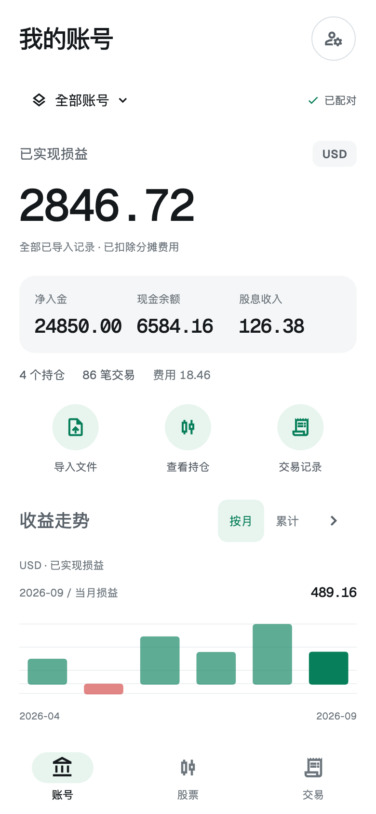
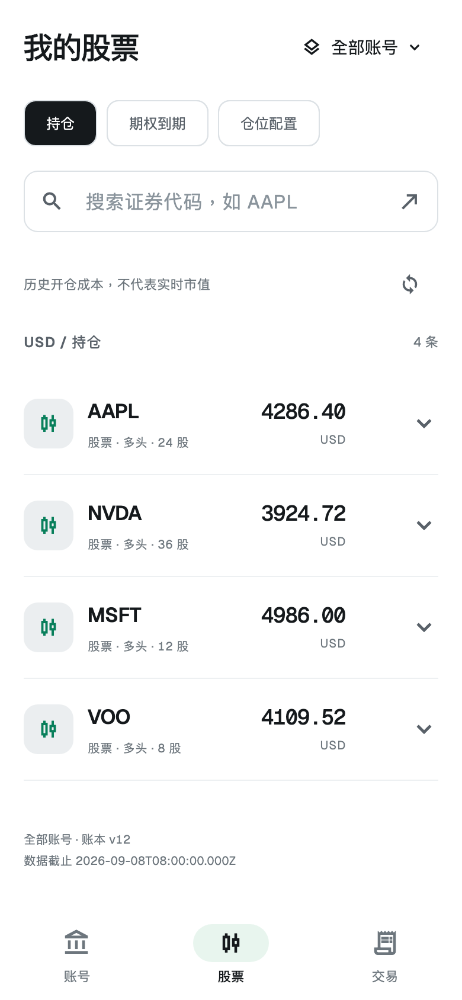
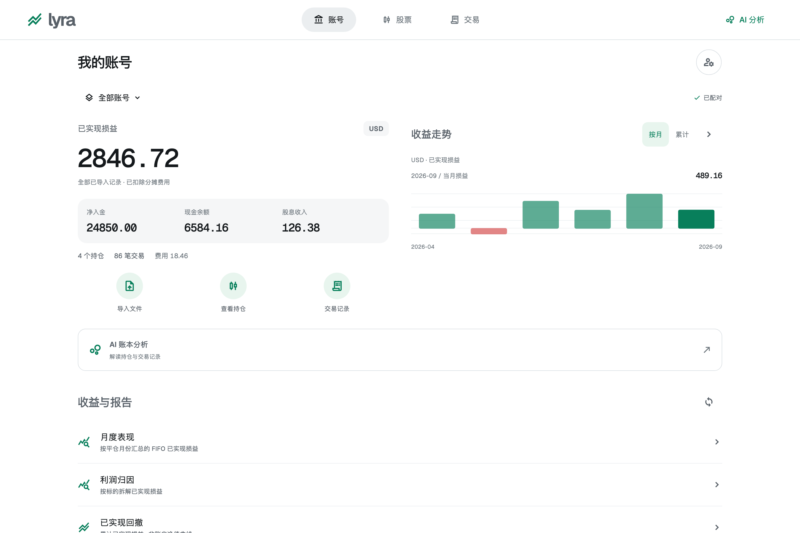

# Lyra · 金融 App 风格迭代

2026-09-08，按用户追加的「按照现在热门金融 App」要求更新。

参考 [Robinhood 投资产品](https://robinhood.com/us/en/invest/) 与 [Revolut 股票产品](https://www.revolut.com/stocks/) 的官方产品展示。重点借鉴金融数据优先、清晰导航、紧凑操作和持仓列表的组织方式，不照搬品牌或行情能力。

## 当前界面

- 白色背景、石墨黑文字、绿色操作与收益图，移除苔绿纸张色、抽象材质图、英文编号和营销式文案。
- 账号首页：账户范围、分币种已实现损益、净入金 / 现金余额 / 股息、导入 / 持仓 / 交易快捷入口、按月 / 累计收益切换。
- 股票页：持仓 / 期权到期 / 仓位配置，搜索证券代码，紧凑列表与可展开明细。
- 交易页：全部交易 / 已实现损益 / 现金流，保留标的、日期与交易动作筛选和游标分页。
- AI 保持二级工具入口。宽屏使用简洁顶栏；手机使用三个带文字的底栏图标。

## 实现边界

继续复用设备配对、安全存储、文件导入、账户范围与报告查询。首页图表和报告共用绘图组件；查询改变会重置所选记录，数据失败显式报错并允许重试。空记录不生成曲线，单条累计记录绘制一个数据点。

金融金额继续保留服务端十进制字符串；仅绘图坐标转成浮点数。跨币种不合计。首页明确展示已实现损益，股票列表明确展示历史开仓成本，未添加实时市值、当日涨跌或未实现收益。期权成本乘数说明保持不变。

首屏和图表保留短过渡动画，支持系统减少动画设置。未添加依赖；所有图标使用原有统一 Material Icons 映射，没有表情符号。原材质资产仅作为历史方案保留，已从 Flutter 资源清单移除。

## 验证

- Flutter 静态分析无问题。
- 55 项测试通过，覆盖原配对 / 导入 / Agent、三个导航入口、公开报告数据、账户筛选、分页、错误重试、320 / 390 / 1440 布局及放大字体。
- 新增首页按月 / 累计切换、请求失败仍保留账号汇总、重试、空记录与单记录验证。
- 使用实际字体生成 Flutter 截图并目视检查。
- Debug APK 构建成功，通过 Android CLI 安装、启动，并检查原生页面。
- 现有模拟器服务端请求失败，真实数据联调未通过。本页带金额的截图全部使用独立合成测试记录，测试数据未进入生产入口。

## 预览

