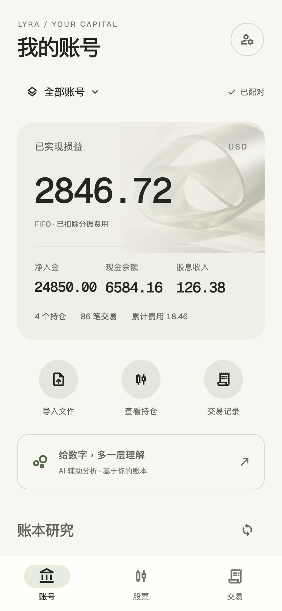
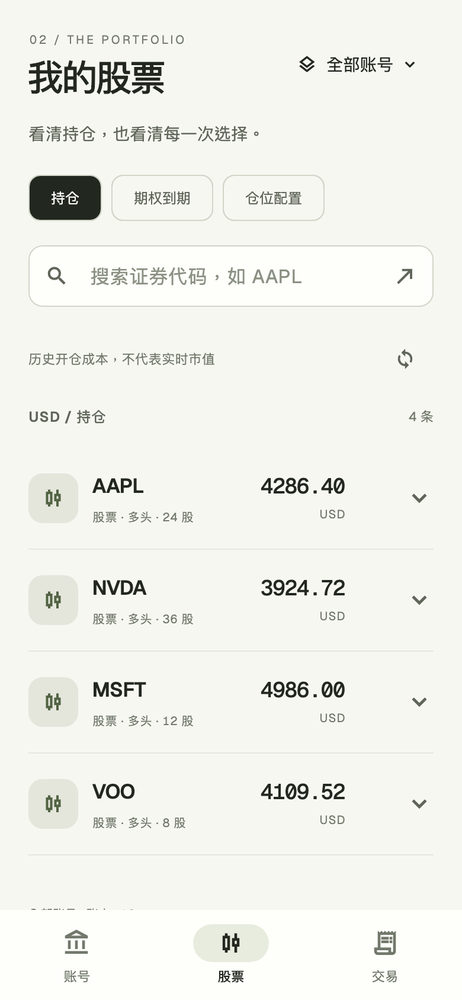

# Lyra 界面重设计 · 2026-09-08

> 本文保留第一轮视觉方案。用户随后指定参考主流金融 App，当前实现与截图见 [金融 App 风格迭代](lyra-finance-app-20260908.md)。

本次信息架构以最新用户要求为准，替代早期方案中的“总览 / 交易记录”双入口。
目标是在现有 Flutter App 内，以账号、股票和交易记录为中心重设计界面，AI 保持辅助地位。

## 页面与 Schwab 能力

| 入口 | 已接入能力 | 数据与计算口径 |
| --- | --- | --- |
| 账号 | 账户选择、summary、设备配对、文件导入 | 不同币种独立呈现；复用原配对与导入流程 |
| 股票 | positions、expiring、allocation | 股票与期权数量、方向、历史成本；到期窗口；成本配置 |
| 交易 | trades、realized、cashflow | 标的、日期、交易动作筛选；服务端游标分页；展开明细 |
| 账号研究 | monthly、attribution、drawdown、holding-period、extremes、streaks、audit | 已实现 FIFO 损益及账本检查 |
| 股票研究 | risk、stress | 长期权已付与短期权已收权利金分列；假设归零损失 |
| AI 分析 | 现有 Agent 会话、工具调用与事件流 | 页内入口与二级返回；既有 AI 会话范围不被界面账户选择静默改变 |

`import / rebuild` 沿用现有提交时自动重建流程。Gmail 导入、对账等已有服务端能力未在本次新增未实现的界面按钮。

## 视觉与交互

- 纸白画布、墨黑主文字、苔绿色交互，盈亏颜色只表达真实金额符号。
- Geist 与 Geist Mono、本机中文字体；数字保留服务端十进制字符串。
- 账号主视觉使用本地抽象材质图，宽屏以非对称版式融合数字与图像。
- 手机底部三个带标签图标入口，宽屏编辑式顶部导航。
- 所有业务图标集中定义于 `LyraIcons`，不使用表情符号。
- 材质图使用阻尼弹簧响应指针，页面与图形有短进入动效；尊重减少动画设置。
- 月度和回撤图支持点选、拖动与悬停读取实际记录，完整金额保留在明细列表。
- 连接、加载、空记录、筛选零结果、错误与重试状态分别呈现。

## 数据不变式

所有只读查询显式携带账户范围；筛选或账户改变时重置分页游标。异步查询缓存键同时包含路由、范围和参数，旧请求不会覆盖新筛选。

跨币种结果不生成客户端合计。金额不使用浮点数重新计算；仅图形坐标和显示百分比使用浮点投影。期权持仓的服务端原始 `cost` 未乘合约乘数，界面同时注明“成本未乘 100”，到期报告则显示服务端 `premiumDollars`。

畸形列表、错误的绘图数值在异步数据边界报错。用户可手动重试，新只读 Provider 不进行隐式后台重试。图像为装饰素材，不作为金融曲线。

## 验收方式

测试包含配对、导入和 Agent 既有回归；新增三个入口导航、320 / 390 / 1440 布局、1.6 倍字体、15 类公开响应、账户与标的筛选、分页重置、错误及重试、多币种分组、畸形响应拒绝。

有数据的视觉验收采用 `test/support/ledger_fixture.dart` 中的合成记录，不读取或公开真实交易。生产入口不导入该测试夹具。可通过 `LYRA_REVIEW_DIR` 输出实际 Flutter 渲染截图；`LYRA_CJK_FONT` 指向验收机器的中文字体，不复制系统字体到项目。

Android 通过 `android run` 安装构建产物、`android layout` 检查语义、`android screen capture` 验收运行效果。

## 图像资产

- 资产：`apps/mobile/assets/images/lyra-orbit.png`
- 生成方式：内置 imagegen，已复制到项目并加入 Flutter assets。
- 提示词：premium editorial abstract 3D material photograph; brushed pale silver and translucent olive glass orbital ribbon on warm ivory stone; museum studio light; tactile surface and soft shadows; restrained ivory, sage and graphite palette; no text, logos, UI, charts, money symbols or neon.

## 最终验收记录

- `flutter analyze --no-pub`：无问题。
- `flutter test --no-pub`：52 项全部通过；加载实际字体并输出截图时同样全部通过。
- `flutter build apk --debug --no-pub`：成功，APK 已通过 Android CLI 安装并启动。
- Android 原生界面的账号 / 股票导航、文本、图标、错误及重试状态已目视检查。
- 模拟器既有配对服务端当前返回请求失败；真实数据端到端联调未据此宣称通过，有数据界面按公开协议使用独立夹具验收。
- 界面源码扫描未发现表情符号；未修改服务端业务计算逻辑。

以下截图为实际 Flutter 渲染，带金额的截图使用合成测试记录。

