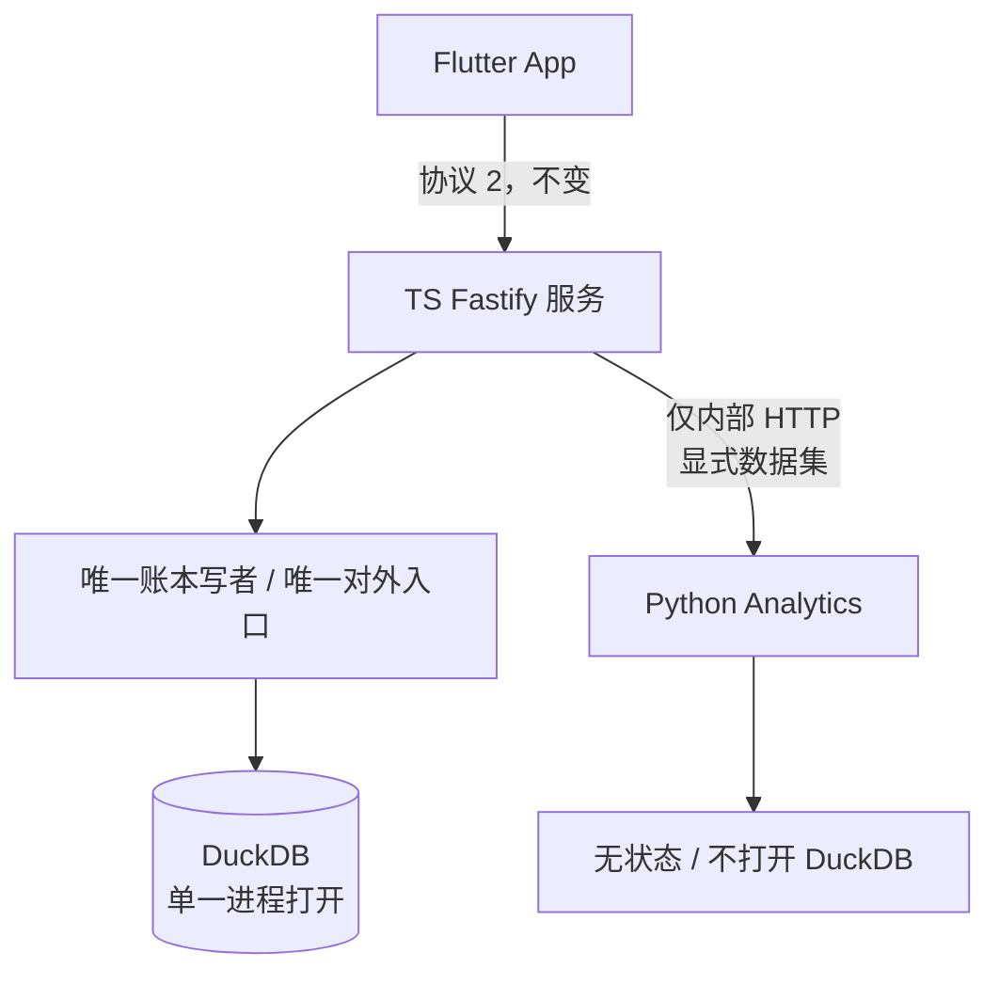

# Lyra Python 分析服务边界与迁移设计

> **文档状态**：设计稿，**尚未实施**。本文档不改变任何代码、数据库 schema 或客户端协议。
> **日期**：2026-10-12
> **结论**：当前不迁移服务端语言；先固化边界、触发条件，以及一项与语言选择无关的先行工作（第 5 节）。
> **⚠️ P0 缺陷（已修复）**：G1 对照实测发现 Lyra 生产代码存在**静默丢单**（eConfirm 多腿成交只入库第一腿且不报错）。**已修复并经 oracle 差分验证**，见[附录 E](#附录-e已验证缺陷econfirm-多腿成交静默丢单2026-10-12)。
> **✅ 差分对照 harness 已落地**：95 条 oracle 录制用例（含 19 份账本 × 16 条分析命令的实测对照）随 `npm run check` 运行，见 §11。
> **相关文档**：[完整方案](lyra-product-technical-design.md)、[实现进度](../progress.md)、[Genkit 与多来源登录](../genkit-oauth.md)、[行情接入与换源](../market-data.md)、[VPS 部署指南](../deployment.md)

---

## 1. 背景与本文档的定位

### 1.1 被评估的提议

将服务端由 TypeScript/Fastify 改为 Python/FastAPI，分三期推进：

| 阶段 | 内容 |
| --- | --- |
| Phase 1 | 保留现有 TS 服务端，不动 |
| Phase 2 | 新增独立 Python Analytics 服务，承接高级金融分析 |
| Phase 3 | 当 Python 承载大部分业务后，合并为单一 FastAPI 服务 |

值得澄清的是：**Python 与 Genkit 是两层问题**。Python 是语言与数据分析生态，Genkit 是 Agent / Flow / Tool 编排。目标形态若要成立，应是「Flutter + FastAPI + Genkit Python」，而不是放弃 Genkit 自研编排。

### 1.2 与既有已确认决策的关系

本提议不是从零选型，而是**推翻一条已确认决策**。[完整方案](lyra-product-technical-design.md) 第 2 节已明确：

> 服务端｜单一 TypeScript 服务，**不拆分 Python**、Agent Gateway 或微服务

第 6.2 节结论：

> 不选择 NestJS、PostgreSQL、Redis、消息队列和**独立 Python 服务**。若未来产品边界变为**公开多租户 SaaS**，再依据真实瓶颈重新评估，而不是提前增加运维负担。

因此，启动迁移需要同时满足两个条件：

1. 出现原决策制定时**未被覆盖的新事实**（新的功能需求，或新的技术约束）；
2. 该新事实**无法在现有单一服务内以更低成本满足**。

注意原决策给出的触发条件是「公开多租户 SaaS」，而当前提议的触发条件是「分析深度」。**这是两个不同的触发条件**，后者并未被原文档论证过，需要独立成立，不能顺带继承前者的结论。

本文档的职责就是把上述两个条件写成可核验的判据（第 3、4、6 节）。

### 1.3 同源现状：`../schwab-cli`

[完整方案](lyra-product-technical-design.md) 第 1 节记录的迁移来源为 `/Users/Gin/Workspace/Schwab`（该路径已不存在）。实际同源项目是 **`/Users/Gin/Workspace/schwab-cli`**，本轮已核对，事实如下：

| 项 | 事实 |
| --- | --- |
| 提交数 | 11 |
| 提交跨度 | 2026-08-01 ~ **2026-08-05**（此后冻结，工作区干净） |
| 源码 | 2,841 行 Python，6 个模块 |
| 测试 | 1,475 行 pytest |
| 依赖 | 仅 `duckdb` + `typer`（**无 pandas / numpy / scipy**） |
| Python | `requires-python >= 3.11` |
| 形态 | 纯 CLI（Typer），**无 HTTP、无认证、无 Agent、无行情** |

命令面与 Lyra 的 17 个账本工具几乎一一对应（对照表见[附录 C](#附录-cschwab-cli-命令--lyra-工具对照)）。

**这一事实对成本模型的影响是双向的**：

- ✅ **降低**了领域层迁移成本：FIFO、CSV/eConfirm 解析、分析口径在 Python 侧已有经过测试的实现，可作为参照甚至直接移植来源。
- ❌ **不影响**基础设施层迁移成本：schwab-cli 完全没有 OAuth / 设备凭据 / 会话轮换 / 多租户归属 / 迁移框架 / 幂等 / 加密备份 / 行情适配 / Agent，而这一层才是重写风险的主体（第 2.3 节）。
- ⚠️ **不可直接复用**分析 SQL：`cli.py` 中的查询针对 schwab-cli 自有的 schema（`db.py`）编写，**不是** Lyra 的 schema 15（含所有者隔离、账本版本、审计、幂等、Agent 表、行情设置）。该重新定向的工作，Lyra 的 TS 实现已经完成——这正是 TS 领域层大量「与 Python 版本一致」注释的含义。

---

## 2. 现状基线（可核验）

### 2.1 Lyra 服务端

| 项 | 值 | 来源 |
| --- | --- | --- |
| 源文件 | 153 个 `.ts` | [附录 B](#附录-b统计口径) |
| 代码行 | 26,387 | 同上 |
| 客户端协议 | 2 | `README.md` |
| 数据库 schema | 15 | 同上 |
| Agent 工具 | 18（17 账本 + 1 只读行情） | [Genkit 与多来源登录](../genkit-oauth.md) |
| Agent SDK | `genkit@1.42.0` + `@genkit-ai/compat-oai@1.42.0` | `server/package.json` |
| 数据库驱动 | `@duckdb/node-api@1.5.5-r.4` | 同上 |
| 运行时 | Node ≥ 22；镜像 `node:24-bookworm-slim` | `server/package.json`、`Dockerfile` |
| 写并发 | `WriteCoordinator`，**进程内**单写队列 | `server/src/application/write-coordinator.ts` |
| 回归基线 | **132 套件 / 400 项，0 失败**（2026-10-12 本轮复跑确认） | 见附录 B |

### 2.2 分层代码量

| 层 | 行数 | 占比 |
| --- | ---: | ---: |
| `application`（会话/账本/导入/登录编排） | 7,294 | 27.6% |
| `infrastructure/db`（DuckDB + 仓储 + 15 版迁移） | 4,205 | 15.9% |
| `infrastructure/gmail` + `domain/gmail` | 3,551 | 13.5% |
| `domain/analytics` | 2,085 | 7.9% |
| `domain/agent` + `infrastructure/agents` | 2,030 | 7.7% |
| `transport`（Fastify 路由 + WS） | 1,577 | 6.0% |
| `domain/ledger` + `domain/fifo` | 1,130 | 4.3% |
| `infrastructure/security` + `infrastructure/auth` | 1,372 | 5.2% |
| 其他（cli / market-data / imports / backup / accounts / audit） | ~3,143 | 11.9% |

### 2.3 结论：可复用面与重打面

| 类别 | 行数 | 占比 | 换 Python 的收益 |
| --- | ---: | ---: | --- |
| 有同源参照的领域语义（analytics + ledger + fifo + gmail 领域 + imports） | 4,901 | 18.6% | **正**：`schwab-cli` 有对应实现 |
| 需全部新写的基础设施（application + db + transport + security + auth + backup + gmail 基础设施） | 17,279 | 65.5% | **负**：纯重打，且是回归高发区 |
| Agent 层 | 2,030 | 7.7% | 中性 |
| 其他（cli + market-data + accounts + audit + 入口） | 2,177 | 8.2% | 中性偏负 |

即：**约 19% 有同源参照，约 66% 是需要全部新写的基础设施。语言迁移的主要成本落在 Python 并不擅长的部分。**

> 口径说明：`imports`（502 行，Schwab CSV/XLSX 解析）计入「有同源参照」，对应 `schwab-cli` 的 `ingest.py`；`infrastructure/gmail`（2,367 行）计入基础设施，因为它承担 OAuth 事务、MIME 解析与增量同步状态，`schwab-cli` 中只有较轻的 `email_ingest.py`。

补充一个常被忽略的规模事实：私人账本的交易量级预计为 10³–10⁴ 笔（**假设，尚未实测**，原因见 §10），现有 `decimal.js` 实现对账与查询在该量级不存在性能问题。**「性能」不构成有效理由，库生态才是。** 这个理由必须写对，否则后续会拿错误论据做决策。

---

## 3. 硬约束（决定边界形状）

### 3.1 约束一：DuckDB 文件同一时刻只允许一个进程打开

本约束**已实测**（原始记录见[附录 A](#附录-a-duckdb-跨进程访问实测记录2026-10-12)）。只要 TS 服务持有读写句柄，第二个进程**即使以 `READ_ONLY` 打开也会失败**：

```text
WRITER: holding read-write connection
READER(READ_ONLY): FAILED -> IO Error: Could not set lock on file "probe.duckdb":
Conflicting lock is held in .../node (PID 53305) by user Gin.
```

推论：

1. 「TS 与 Python 共享同一个账本文件」这一形态**在 DuckDB 上不成立**，即使 Python 只读。
2. 跨进程的唯一可行形态是**数据集边界**：由 TS 从账本导出只读数据集，传给 Python。**是数据过界，不是文件共享。**
3. Python 侧不得持有账本真相，不得成为账本的第二个写者。
4. 现有 `WriteCoordinator` 只保证进程内串行，**对第二个进程无效**，不能作为共享文件的缓解措施。

> 附注：Python 的 `duckdb` 驱动生态确实比 Node 侧成熟（Node 侧当前是 `1.5.5-r.4` 预发布版）。但**跨进程限制与语言无关**，两边行为一致。这一条不构成换语言的理由。

### 3.2 约束二：账务精度必须是十进制，且已由项目规范固定

[完整方案](lyra-product-technical-design.md) §6.3 已规定：领域层金额/数量/成本/价格/收益率统一使用 `Decimal`；REST 与 WebSocket 的精确数值序列化为**十进制字符串**；客户端不使用 `double`。

现有实现已遵守，例如 `server/src/domain/analytics/types.ts` 中 `netDeposits: string`、`realizedPnlTotal: string`。

推论：

1. Python 侧账务口径必须使用 `decimal.Decimal`，**不得**用 numpy / pandas 的 `float64` 承接金额。
2. 跨语言传递金额一律十进制字符串，**禁止 JSON number**。
3. `numpy` / `scipy` / `pandas` 只允许用于**新增的统计与模拟负载**，且其输出在进入账务口径前必须显式十进制化。

这条一旦搞错，是产品质量问题，而不是风格问题。

### 3.3 约束三：schema 迁移不可逆，加密备份受主密钥约束

- 当前 schema 15；`README.md` 明确「旧服务端不能直接打开已升级数据库」。
- `infrastructure/backup/encrypted-backup.ts`（464 行）的加密备份格式与主密钥绑定。

推论：任何「两套服务端并存」的方案都必须保证**只有一个 schema 写入者**。Python 服务不得执行迁移，也不得引入自己的 schema 版本序列。

---

## 4. 边界设计

> 本节描述的是**触发条件满足后**才实施的形态。当前不创建任何 Python 目录。

### 4.1 形态选择

| 维度 | 方案 A：Python 藏在 TS 之后 | 方案 B：Python 直接对 Flutter 暴露 |
| --- | --- | --- |
| 客户端协议 | **不变（保持协议 2）** | 需升位并同步改 App |
| 认证 | 复用 TS 现有 OAuth 设备凭据 | 需第二套认证路径，凭据面翻倍 |
| schema 写入者 | TS 唯一 | 需重新划分，违反 §3.3 |
| 灰度与回退 | 摘掉内部调用即可回退 | 客户端需处理服务缺失 |
| 故障影响面 | 仅新分析能力 | 登录与账本一并暴露 |

**选择方案 A。** 依据是：Flutter 协议版本为 2、18 个工具全部只读，因此 Python 服务可以完全作为 TS 的实现细节存在——**客户端零改动、协议版本不升位**，也避免第二套认证路径。

### 4.2 目标形态



### 4.3 职责矩阵

| 能力 | 归属 | 理由 |
| --- | --- | --- |
| OAuth / 设备凭据 / 会话轮换 | TS | 已实现并验证，重写风险最高 |
| 账本 schema / 迁移 / 审计 / 幂等 | TS | schema 15 不可逆（§3.3） |
| FIFO / 已实现盈亏 / 现有 17 个工具口径 | **TS** | 已用 Decimal 实现，**重叠指标不实现第二遍** |
| 账户范围 / 账本版本 / 截止时间 | TS | 现有会话边界的权威来源 |
| 行情适配 / 缓存 / 请求预算 | TS | 已实现并有换源语义 |
| Agent 编排 / 工具循环 / 流式 | TS（现阶段） | Genkit TS 成熟度更高 |
| 新增统计与模拟负载 | Python（触发后） | 生态优势：优化、回归、模拟、回测 |
| 账本写入 | **仅 TS** | §3.1 + §3.3 |

### 4.4 数据契约规则（规范性）

以下为规范，**必须遵守**；具体字段名为草案，实施前须复核。

- **R1 显式数据集**：请求必须携带完整输入数据集。Python 不得回查账本，不得访问 DuckDB 文件，不得隐式读取任何服务端状态。
- **R2 显式时点**：`as_of` 必填。Python 不读系统时间，保证同一请求可重放。
- **R3 显式范围**：账户范围沿用现有 `AccountScope` 语义（`{kind:"all"}` 或 `{kind:"account", account}`，见 `server/src/domain/analytics/scope.ts`），并在响应中回显。
- **R4 十进制字符串**：所有金额、数量、价格、比率以字符串传输；**禁止 JSON number**（§3.2）。
- **R5 只读**：响应只包含计算结果与诊断信息，不得包含可写回账本的记录。
- **R6 可复现**：任何随机过程必须接受显式 `seed`，并在诊断中回显。
- **R7 有界**：模拟次数 / 路径数 / 输入行数设上限；超限返回显式拒绝，**不得静默截断或降采样**。
- **R8 失败即失败**：能力不可用时返回明确错误，**不得返回 0、近似值或缓存的旧结果**（与 `README.md`「缺价不会中断账本」「不补零」的既有原则一致）。

请求与响应的草案形状（示意，非定稿）：

```jsonc
// POST /analytics/v1/<capability>   —— 仅内部调用
{
  "request_id": "…",
  "as_of": "2026-10-12T00:00:00+08:00",
  "account_scope": { "kind": "all" },
  "ledger_version": 42,           // 仅回显，用于结果溯源
  "dataset": { "positions": [], "realized": [], "cash_flows": [] },
  "parameters": { "seed": 1, "trials": 10000 }
}

// 响应
{
  "request_id": "…",
  "as_of": "…",
  "ledger_version": 42,
  "status": "ok",                  // ok | insufficient_data | rejected
  "result": { /* 仅统计量与聚合，金额为十进制字符串 */ },
  "diagnostics": { "input_rows": 0, "elapsed_ms": 0, "library_versions": {}, "seed": 1 }
}
```

### 4.5 DuckDB 访问策略

- TS 是**唯一打开者**与**唯一写者**。
- 数据流向：TS 从账本读取 → 构造数据集 → 内部 HTTP 传给 Python。
- **否决**「Python 读只读副本」：副本与账本版本可能不一致，会破坏 `README.md`「App 查询和助手共享数据口径」的既有保证，也违反本项目「所有金融结果都明确标示账本版本」的第一优先级。
- 响应必须回显 `ledger_version`，供上层判断结果是否已过期。

### 4.6 认证与网络边界

- **Flutter 永不直连 Python。**
- Python 只监听 loopback 或 Compose 内部网络，**不发布端口**。
- 服务间使用独立凭证（共享密钥或 mTLS），**不得复用** OAuth 设备凭据。
- Python 服务**不得**接触 `server/.env` 中的 OAuth / 模型 / 行情密钥。

### 4.7 部署与运维

- `deploy/compose.yaml` 增加一个**无状态**服务，不增加持久卷。
- 沿用项目既有习惯：启动前配置预检（`server/src/cli/check-config.ts` 模式）、健康检查、SIGTERM 退出宽限。
- 备份策略不变：Python 无状态，不参与 `encrypted-backup` 流程。
- 需固定解释器版本（环境事实见 §7）。

---

## 5. 与语言选择无关的先行工作（推荐现在做）

### 5.1 差分对照测试

**现状**：本轮核对确认，Lyra 的 115 个测试文件（132 套件）中，**没有任何一个**把 `schwab-cli` 当作外部基准做语义对照（`test/` 下无调用 Python CLI 的用例）。

**建议**：建立以 `schwab-cli` 为 oracle 的差分测试。

| 项 | 内容 |
| --- | --- |
| 输入语料 | 可**机械提取**：`schwab-cli` 的 69 个用例用 `write_csv()` / `_trade_block()` / `_raw_gmail_record()` **内联构造**输入，仓库内无夹具文件；由 pytest 钩子导出即可得到共享语料。实际共产出 **95 条**用例（含 19 份可重建账本） |
| 执行 | 同一输入分别进入 `schwab --json …`（独立 DB）与 Lyra 领域层。**oracle 已在本机跑通**（§5.3） |
| 比对 | 按**数值语义**比较，见下方「比对规则」 |
| 覆盖边界 | 仅领域口径；**不覆盖** auth / db / agent / 行情 |
| 已知限制 | schwab-cli 无所有者隔离、无账本版本、无多币种，超出其口径的部分不可对照 |

**比对规则**（三条均由 2026-10-12 实测发现，原始记录见[附录 D](#附录-d差分对照实测记录2026-10-12)）：

1. **比值，不比字符串。** 两边十进制渲染位数不同：同一个数量，Python 输出 `"5.000000"`，Lyra 输出 `"5"`。比对前必须归一化为数值。
2. **比集合，不比数组顺序。** Python 的 `realized --json` 按 `realized_id` 倒序返回，Lyra 的 `realizedRecords` 按 FIFO 消耗顺序。必须先按稳定业务键（`account, symbol_key, open_date, close_date, qty`）排序。
3. **存储列与推导列用不同精度策略。** 存储列（`strike` 4 位，`quantity` / `price` / `fees` 6 位，`pnl` 4 位）应逐位一致；推导列（如 `cost = remaining_qty × open_price`）会因 DuckDB 精度推导而扩展（实测 12 位），只能按数值比较。

### 5.3 oracle 已跑通（G3 已解除）

`schwab-cli` **可在当前沙箱内执行，无需放宽任何权限**。原失败原因是 `uv` 需要写 `~/.cache/uv` 与项目内 `.venv`，二者都在工作区之外。把三处位置重定向到工作区即可：

```bash
export UV_CACHE_DIR=<workdir>/.uv-tmp/cache
export UV_PYTHON_INSTALL_DIR=<workdir>/.uv-tmp/python
export UV_PROJECT_ENVIRONMENT=<workdir>/.uv-tmp/venv
uv run --python 3.12 schwab --help
```

已实测通过 `import` → `rebuild` → `positions` / `summary` / `realized` 全链路。注意 `--db` 与 `--json` 是**子命令级**选项，须写在子命令之后（`schwab positions --db <path> --json`）。

### 5.2 为什么这是最高性价比的一步

1. **它同时服务两种未来。** 无论最终是否迁移 Python，领域口径的可核验性都是必需资产。
2. **它是迁移的前置条件，不是绕路。** 任何 Phase 2/3 方案都必须回答「新旧实现是否同口径」；先有 oracle，这个问题才有答案。
3. **它成本低、风险为零。** 只读、不改 schema、不改协议、不引入运行时依赖。
4. **它顺带检查同源关系——并已推翻「无漂移」的推断。** `schwab-cli` 冻结于 2026-08-05，Lyra 的 TS 移植在其后（[完整方案](lyra-product-technical-design.md) 日期为 2026-08-30），原先据此判断「不存在二者并行演化的窗口」。**实测证明该推断不成立**：移植实际基于更早的提交状态，遗漏了 `d990630`、`c139216`、`2243ef7` 三个提交，已在 eConfirm 解析上造成**可复现的静默丢单**（见[附录 E](#附录-e已验证缺陷econfirm-多腿成交静默丢单2026-10-12)）。这是「按提交时间推断语义等价不可靠」的实证。

> 需要明确的是：本节不构成迁移承诺，也不改变第 6 节的触发条件。

---

## 6. 触发条件（可观测判据）

### 6.1 进入 Phase 2：引入 Python 分析服务

**须同时满足**：

- **T1** 出现至少一个已被产品确认的需求，且满足以下任一：TS 生态缺少可用实现，或自研成本显著高于使用成熟库。
  候选清单（均**不属于**现有 18 个工具的既有口径）：Monte Carlo 压力测试、带约束的组合优化、因子回归/风险模型、历史回测引擎。
- **T2** 该需求为**只读分析**，不参与账本写入。
- **T3** 其全部输入可由 TS 导出为数据集，无需 Python 直接查账本（由 §3.1 强制）。

未满足时的默认动作：**在 TS 内实现，先测量**；不预先建服务。

### 6.2 进入 Phase 3：合并为单一 FastAPI 服务

**须同时满足**：

- **T4** T1–T3 长期成立，且 Python 侧持续承载 > 50% 的新增业务代码（以连续 3 个自然月的提交统计为准）。
- **T5** Python Genkit 已发布稳定 1.0（当前仍为 preview，时点以官方文档为准）。
- **T6** 已具备可执行的完整迁移回归清单。规模基线：**132 套件 / 400 项**（2026-10-12 复跑确认）。
- **T7** 明确接受重写 `security`（793 行）、`infrastructure/auth`（579 行）、`infrastructure/db`（4,205 行，含 15 版迁移）三层——这三层是本项目历史上回归最集中的部分。

### 6.3 否决条件（出现即不迁移）

- **D1** 理由是「Python 比 TS 好」或「性能」：见 §2.3 末段。
- **D2** 方案要求 Python 与 TS 共享同一个 DuckDB 文件：违反 §3.1。
- **D3** 方案允许 Python 侧以 `float64` 承接账务金额：违反 §3.2。

---

## 7. 环境事实（2026-10-12 本轮核对）

| 项 | 值 | 影响 |
| --- | --- | --- |
| 系统 `python3` | **3.9.6** | 不满足 Phase 2 设想的 3.12+，需由 uv 管理解释器 |
| `uv` | 0.11.16 已安装 | 骨架搭建成本低 |
| `duckdb`（Python 包） | 未安装 | 需声明依赖 |
| Node | v22.22.3（本机）；镜像 `node:24-bookworm-slim` | 双运行时意味着两套版本面 |
| `schwab-cli` 解释器要求 | `>=3.11` | 与 Phase 2 设想的下限不完全一致，需统一 |

结论：搭骨架成本低，但**部署侧需新增运行时与镜像层**，运维面扩大。

---

## 8. 非目标

- 不重写 OAuth / 设备凭据 / 会话轮换。
- 不修改 schema 15，不新增迁移版本。
- 不提升客户端协议版本（保持 2）。
- 不引入 ORM、消息队列、缓存中间件、微服务网关。
- **不把现有 18 个只读金融工具搬到 Python**——同一口径实现两遍必然引入漂移风险，并使第 5 节的对照成本翻倍。
- 不在 Phase 2 触发条件满足前创建任何 Python 目录、依赖声明或 CI 任务。

---

## 9. 待决问题

| 编号 | 问题 | 阻塞对象 |
| --- | --- | --- |
| Q1 | 若 T1 出现，Python 服务与 TS 服务是同机 Compose 部署，还是要求独立主机？ | §4.7 |
| Q2 | 数据集导出的上限（行数 / 字节）如何确定？需真实量级账本数据 | R7 |
| Q3 | 仅 loopback 场景下，服务间凭证是否仍需 mTLS？ | §4.6 |
| Q4 | 是否需要提前定义「分析能力目录」（能力名、版本）？当前判断为**不需要**，属预测性抽象 | §4.4 |

---

## 10. 本轮调查的已知缺口

以下为 2026-10-12 核对后的**缺口状态**。未闭合项不得在后续引用本文档时当作已验证。

| 编号 | 缺口 | 状态 | 依据 / 闭合方式 |
| --- | --- | --- | --- |
| **G1** | 同源等效性 | **已由 harness 看守** | 5 路代码级比对 + oracle 差分实测。**FIFO 核心数值一致**（[附录 D](#附录-d差分对照实测记录2026-10-12)）；**eConfirm 多腿静默丢单已修复并验证**（[附录 E](#附录-e已验证缺陷econfirm-多腿成交静默丢单2026-10-12)）；95 条录制用例持续看守，**含 19 份账本 × 16 条分析命令的实测对照**（§11） |
| **G2** | 本地没有真实语料 | **未闭合** | `server/data/lyra.duckdb`（2.6 MB）含 28 张表/视图，但 `transactions`、`accounts`、`audit_events` 均为 **0 行**（已只读查询确认）。当前语料来自 oracle 测试的内联构造，覆盖解析边界但不覆盖真实券商数据 |
| **G3** | `schwab-cli` 无法在当前沙箱内执行 | **已闭合** | 三处 uv 路径重定向进工作区后全链路跑通（§5.3），**无需放宽权限**；已封装为 `npm run parity:record` |
| **G4** | 数据规模未实测 | **未闭合** | 依赖 G2。§2.3 的 10³–10⁴ 笔仍为假设 |
| **G5** | eConfirm 解析边界 | **部分闭合，并发现第二处缺陷** | 28 条 eConfirm 用例已纳入对照；多腿丢单已修复。另发现**信息残桩跳过机制缺失**（合法 HTML-only 邮件被整封拒绝），已作为绊线记入 `KNOWN_LYRA_DEFECTS`，**未修复** |

**对结论的影响**：

- **决策层（第 3、4、6 节）不受影响。** DuckDB 跨进程锁为实测结论；十进制精度与 schema 不可逆来自项目既有规范与代码；触发条件不依赖上述缺口。
- **实施层**：G3 已闭合，harness 已落地并接入主回归；剩余前置仅为 G2 的真实语料与覆盖更多边界的对照。

---

## 11. 实施级方案：差分对照 harness

**已落地**（2026-10-12）。本节记录实际实现，与最初计划的差异也在下表标注。

### 11.1 实际结果

| 项 | 结果 |
| --- | --- |
| 录制用例 | **95 条**：`csv` 35 / `econfirm` 28 / `fifo` 13 / **`analytics` 19**；其中异常路径 12 条 |
| 实际参与比对 | **83 条**（9 条不覆盖、2 条跳过、1 条为已确认缺陷绊线）；19 条分析层用例全部参与 |
| 分析层规模 | **19 份账本 × 16 条命令 = 304 次命令级比对**，逐命令比对字段数 3–19 |
| 测试规模 | `npm run check` 扩展到 **139 套件 / 514 项**，0 失败 |
| 覆盖边界 | ① eConfirm 八列桥接输出 ② CSV 导入后的 transactions ③ FIFO 的 lots 与 realized ④ **16 个分析命令的完整 JSON 输出** |
| 未覆盖 | G2 的真实券商语料；多次导入与多文件重放的累计账本状态（9 条） |

### 11.2 实现步骤与状态

| # | 步骤 | 状态 | 产物 |
| --- | --- | --- | --- |
| 1 | 语料导出 | ✅ **改法优于原计划**：不修改 `schwab-cli`，改用运行时 shim | `server/scripts/parity/record-fixtures.py` |
| 2 | oracle 录制 | ✅ **与步骤 1 合并为一次运行**：shim 同时记录输入与真实输出 | `server/test/parity-fixtures.ts`（生成物，已提交） |
| 3 | Lyra 执行器 | ✅ | `server/test/parity-harness.ts` |
| 4 | 比较器与白名单 | ✅ | 同上 |
| 4b | **分析命令实测对照** | ✅ 原计划 B2/B3 的完整范围 | 19 份账本 × 16 条命令，见 11.5 |
| 5 | CI 接入 | ⚠️ **不需要**：仓库无 `.github`；对照测试是普通 `node:test` 用例，随 `npm run check` 运行，且不依赖 Python | — |
| 6 | 修 P0 | ✅ 已完成并经 oracle 差分验证 | 见[附录 E](#附录-e已验证缺陷econfirm-多腿成交静默丢单2026-10-12) |
| 7 | 元测试 | ✅ **计划外加项**：证明比较器真的会因差异失败 | `server/test/parity-meta.test.ts` |

**与计划的三处偏离**（均为改进）：

1. 原计划要改 `schwab-cli/tests/conftest.py`。实际用 `sys.modules` 全局名字替换做 shim，**外部仓库零改动**。
2. 原计划分「语料导出」与「oracle 执行」两步。实际合并为一次 pytest 运行，输入与期望值天然对应。
3. 原计划需要 CI job。实际不需要——因为 golden 已提交，测试是纯 Node 的，随主回归一起跑。

### 11.3 重放命令

```bash
npm run parity:record   # 重新录制；需要 oracle 仓库，可用 LYRA_ORACLE_DIR 指定
```

录制**可复现**：连跑两次产出逐字节相同（已实测）。首次录制会把 uv 的缓存、解释器与虚拟环境下载到 `.uv-tmp/`（已 gitignore），**无需放宽任何沙箱权限**。

### 11.4 关键约束（均由本轮实测得出）

1. **比值不比串**：同一个数，Python 输出 `"5.000000"`，Lyra 输出 `"5"`。
2. **比集合不比序**：`realized` 在 A 侧按 `realized_id DESC`，B 侧按 FIFO 消耗顺序。
3. **存储列 vs 推导列**：`cost` 等推导列在 DuckDB 中会扩展标度（实测 12 位）。
4. **⚠️ oracle 不是真值**（本节最重要的结论）：`holding-period.average_lot_pnl` 中，A 走 DuckDB `avg()` **降级为 DOUBLE**，实测对 `pnl=[0.0001, 0.0002]` 给出 `0.0001`，而精确十进制为 `0.0002`——**A 错、B 对**。因此「与 oracle 相等」**不能作为正确性判据**，比较器必须能表达「此处以精确十进制为准」。

### 11.5 差异白名单（现状）

比较器优先用**结构归一**消化格式差异，只有真正无法归一、且已判定为可接受的条目才进白名单。当前白名单**只有 1 条**：

| 类别 | 条目 | 处置 | 命中 |
| --- | --- | --- | --- |
| **白名单（唯一）** | `audit.scopeNote`：oracle 写「本命令」、Lyra 写「本功能」 | 显式白名单，仅人读文案 | 19/19 |
| 序列化尾零 | 明细金额 `"5.000000"` vs `"5"` | 比较器按**数值**归一，非白名单 | — |
| 排序 tie-break | 同 `close_date` 内行序 | 数组按**多重集**比较，非白名单 | — |
| 列集合 / 脱敏 | 删除哈希、`account→accountId`、`raw_symbol→symbol` | 键名 snake→camel 归一后只比**交集** | — |
| 分页 | `realized`/`cashflow` 无 LIMIT vs 默认 50 | 两侧同用默认值；语料行数远小于上限，未触发 | — |
| 空集文本 | `"0"` vs `"0.0000"` | 数值归一 | — |
| **已确认缺陷** | eConfirm 信息残桩跳过缺失 | **绊线断言**（非白名单），修复后会失败 | — |
| **已删除的条目** | `holding-period.average_lot_pnl`（oracle 的 DuckDB `avg()` 降级 DOUBLE） | 实测在 19 份账本上**零命中**，属死条目，已删除；缺陷本身记录于此，若未来触发会失败并强制重新决策 | 0 |

> **死条目必须删除。** 白名单一旦存在永不命中的条目，就说明它不是在描述真实差异，而是在预留「以后可能放过什么」——这正是让 harness 失效的方式。测试中有断言把这件事钉住：白名单命中数为 0 即失败。

### 11.6 分析层对照的比对方式

oracle 输出 CLI 的 JSON（snake_case），Lyra 侧直接调用领域函数（镜像 `financial-tool-runtime.ts` 的回调，同样的账户范围与默认参数）。两侧结构差异较大，因此不做逐字段手工映射，而是把两边都扁平化为「路径 → 归一化值」后比较**交集**：

1. 键名 snake_case → camelCase 归一，同名字段自动对齐；
2. 数值归一，吸收 Decimal 渲染位数差异；
3. 记录数组按**字段**拉平成多重集，既吸收行序差异又保留字段级可比性（若把整个数组折成一个叶子，粒度太粗且无法定位字段）；
4. 只在单侧存在的路径视为呈现层差异，不计失败。

**防「空比对假通过」**：每条命令设有**最小比对字段数**，且汇总断言要求「每个命令至少有一份账本比到 3 个以上字段」。若两侧键名全部对不上，比对数为 0，测试必须失败而不是静默通过。元测试中有一条专门验证这个闸门。

### 11.7 明确不做

- 不把 harness 做成生产依赖；它只服务于口径可信度。
- 不为 harness 引入新的服务端运行时依赖。
- 不因 harness 存在就启动 Phase 2/3——触发条件（§6）不变。

---

## 附录 A：DuckDB 跨进程访问实测记录（2026-10-12）

环境：macOS，Node v22.22.3，`@duckdb/node-api@1.5.5-r.4`（与 `server/package.json` 锁定版本一致）。

方法：进程一以默认读写模式打开 DuckDB 并持有连接；进程二以 `access_mode: "READ_ONLY"` 尝试连接并查询。

结果：

```text
WRITER: holding read-write connection
READER(READ_ONLY): FAILED -> IO Error: Could not set lock on file "probe.duckdb":
Conflicting lock is held in /Users/Gin/.nvm/versions/node/v22.22.3/bin/node (PID 53305)
by user Gin. See also https://duckdb.org/docs/stable/connect/concurrency
```

结论：写入进程持有文件锁期间，第二个进程（含只读）无法打开同一数据库文件。探针文件与临时目录已清理，仓库工作区未留下改动。

---

## 附录 B：统计口径

```bash
# 源文件数与代码行
find server/src -name '*.ts' | wc -l                    # 153
find server/src -name '*.ts' -exec cat {} + | wc -l     # 26387

# 回归基线（2026-10-12 复跑）
npm run check
# tests 400 / suites 132 / pass 400 / fail 0 / cancelled 0 / skipped 0
```

`132 套件 / 400 项`与 [`docs/progress.md`](../progress.md) 记录一致，本轮复跑确认仍全部通过。

---

## 附录 C：schwab-cli 命令 ↔ Lyra 工具对照

| `schwab-cli` 命令 | Lyra 工具 | 归属 |
| --- | --- | --- |
| `import` | 导入流程（非工具） | TS |
| `import-email` / `reconcile` | Gmail 同步与对账（`gmail-routes`） | TS |
| `rebuild` | FIFO 重放（`domain/fifo`） | TS |
| `audit` | `audit` | TS |
| `positions` | `positions` | TS |
| `expiring` | `expiring` | TS |
| `summary` | `summary` | TS |
| `monthly` | `monthly` | TS |
| `allocation` | `allocation` | TS |
| `attribution` | `attribution` | TS |
| `drawdown` | `drawdown` | TS |
| `risk` | `risk` | TS |
| `holding-period` | `holding-period` | TS |
| `extremes` | `extremes` | TS |
| `streaks` | `streaks` | TS |
| `stress` | `stress` | TS |
| `realized` | `realized` | TS |
| `trades` | `trades` | TS |
| `cashflow` | `cashflow` | TS |
| — | `accounts` | TS（Lyra 新增） |
| — | `market-positions` | TS（Lyra 新增，含行情适配） |

即：**17 个账本工具全部有同源对应，2 个为 Lyra 新增。** 除此之外的 auth / session / schema / transport / agent / backup 在 schwab-cli 中完全不存在。

---

## 附录 D：差分对照实测记录（2026-10-12）

这是本项目的**首个** TS ↔ Python 口径实测对照，用于验证 §5.1 的 harness 思路可行，并暴露比对规则。

### D.1 输入语料

取 `schwab-cli` 已有测试用例的原始行（`tests/test_fifo_replay` 对应的一组三段式跨批次 FIFO），**同一批行同时喂给两边**：

```text
01/05/2026  Buy   INTC  10 @ $40.00  fees 0  amount -$400.00
01/06/2026  Buy   INTC  10 @ $50.00  fees 0  amount -$500.00
01/10/2026  Sell  INTC  15 @ $60.00  fees 0  amount +$900.00
```

### D.2 Lyra 侧

调用编译产物的 `normalizeTransactionBatch` + `replayFifo`：

```json
{"realized":[
  {"open_date":"2026-01-05","close_date":"2026-01-10","qty":"10","open_price":"40","close_price":"60","open_fees":"0","close_fees":"0","pnl":"200.0000"},
  {"open_date":"2026-01-06","close_date":"2026-01-10","qty":"5","open_price":"50","close_price":"60","open_fees":"0","close_fees":"0","pnl":"50.0000"}],
 "open_lots":[{"open_date":"2026-01-06","remaining_qty":"5","open_price":"50"}]}
```

### D.3 Python oracle 侧

```bash
schwab import --db <path> <csv>     # 3 行，新增 3，跳过 0
schwab rebuild --db <path>          # 未平批次 1，已实现记录 2，合计 $250.0000
schwab realized --db <path> --json
schwab positions --db <path> --json
```

```json
{"rows":[
  {"open_date":"2026-01-06","close_date":"2026-01-10","qty":"5.000000","open_price":"50.000000","close_price":"60.000000","pnl":"50.0000"},
  {"open_date":"2026-01-05","close_date":"2026-01-10","qty":"10.000000","open_price":"40.000000","close_price":"60.000000","pnl":"200.0000"}],
 "count":2,"total_pnl":"250.0000"}
```

### D.4 对照结果

| 口径点 | Python oracle | Lyra | 判定 |
| --- | --- | --- | --- |
| 已实现记录数 | 2 | 2 | 一致 |
| 合计损益 | `250.0000` | 200.0000 + 50.0000 | 一致 |
| 批次 1：qty / open / close / pnl | `10.000000` / `40.000000` / `60.000000` / `200.0000` | `10` / `40` / `60` / `200.0000` | **数值一致**，渲染位数不同 |
| 批次 2：qty / open / close / pnl | `5.000000` / `50.000000` / `60.000000` / `50.0000` | `5` / `50` / `60` / `50.0000` | **数值一致**，渲染位数不同 |
| 未平批次：remaining / open_price | `5.000000` / `50.000000` | `5` / `50` | 数值一致 |
| 未平批次 first_open_date | `2026-01-06` | `2026-01-06` | 一致 |

**结论：FIFO 消耗顺序、开仓价选取、已实现盈亏数值全部一致。**

### D.5 本次实测发现的三条比对规则

1. **不能比字符串。** `"5.000000"`（Python）与 `"5"`（Lyra）是同一个数。
2. **不能比数组顺序。** Python 按 `realized_id` 倒序返回（id 2 在前），Lyra 按 FIFO 消耗顺序（最早的批次在前）。
3. **推导列与存储列精度策略不同。** `cost = remaining_qty × open_price` 在 DuckDB 中推导为 12 位（实测 `"250.000000000000"`），而存储列是固定 4/6 位。

### D.6 覆盖度声明

本次覆盖 **FIFO 核心（股票 3 行语料）+ eConfirm 多腿单例（附录 E）**。**不含**：期权乘数与到期/指派、费用分摊与部分平仓尾差、日期 as-of 语义、哈希与幂等的完整面，以及全部 19 个分析命令中的绝大部分（仅完成代码级比对，未做实测）。**不得据此宣称整体等效。**

---

## 附录 E：已验证缺陷——eConfirm 多腿成交静默丢单（2026-10-12）

**这是本轮 G1 的唯一 P0 级发现：一个已实测确认、可复现的静默数据丢失缺陷。**

### E.1 缺陷性质

同一封多腿成交确认邮件，Python 侧解析出 **2 笔**成交，Lyra 侧只解析出 **1 笔**，且**不抛任何错误**。

### E.2 根因

`schwab-cli` 在冻结前用提交 `d990630` 加了一个守卫，Lyra 的移植**没有包含该提交**。

Python 侧 `schwab-cli/src/schwab/email_ingest.py:521-523`（该文件在 Lyra 仓库之外，故不作链接）：

```python
if disclosure_index is not None and "Totals" not in values:
    # 含 Totals 的多价格模板也用该文本分隔成交腿，需留给逐腿解析。
    values = values[:disclosure_index]
```

Lyra `server/src/domain/gmail/econfirm.ts:222-225`（**缺 `"Totals" not in values` 守卫**）：

```ts
const disclosureIndex = values.findIndex((value) => value.toLowerCase().startsWith("for the above:"));
if (disclosureIndex >= 0) {
  values = values.slice(0, disclosureIndex);
}
```

在「先出现 `For the above:`、后出现 `Totals`」的多腿模板中，Lyra 把 `Totals` 一并截掉 → `values.indexOf("Totals")` 返回 `-1` → 落到单笔分支 (`econfirm.ts:264-296`) → 只解析第一段，且第一段恰好能通过全部勾稽检查 → **不报错**。

### E.3 实测证据

样本取自 `schwab-cli/tests/test_email_ingest.py:447-469`（其注释记录为**真实 Schwab 邮件示例**，INTC 两腿成交）。同一封邮件分别喂给两边的**真实解析器**：

```text
PY 成交笔数 = 2
    10.00000 86.550000000 fees=0.00 amount=-865.50
    10.00000 86.160000000 fees=0.00 amount=-861.60

TS 成交笔数 = 1
    10 86.55 fees=0 amount=-865.5
```

### E.4 影响

- 持仓数量与成本偏低，已实现损益随之错误——而 Lyra 的核心价值主张是「数据可信度第一」。
- 违背后端自身的错误处理原则：静默产出不完整且**看起来成功**的结果。
- 对账结论分叉：Python 侧该腿为 `matched`，Lyra 侧为 `missing`。

### E.5 为什么现有测试没有拦住

`server/test/econfirm.test.ts:149-167` 覆盖的多腿用例**没有 `For the above:` 分隔符**（`Totals` 直接跟随成交行），走的正是 Lyra 能正确处理的分支。缺陷恰好落在**测试未覆盖的那一种排版**上。

### E.6 状态：**已修复**（2026-10-12）

修复范围**大于「移植一行守卫」**。仅加守卫会把「静默丢单」变成「硬报错」，两者都不可接受——`Totals` 分支还必须能按分隔符拆腿。实际改动三处，均在 `server/src/domain/gmail/econfirm.ts`：

| 改动 | 内容 |
| --- | --- |
| A1 | 披露截断加 `!values.includes("Totals")` 守卫 |
| A2 | `Totals` 分支按 `For the above:` 分隔符拆腿，逐腿调用 `parseLabeledFees`；丢弃结束标记；费用校验由「必须为 0」改为「逐腿合计 == Totals」 |
| A3 | `parseLabeledFees` 增加 `[N/A:, $0.00, N/A, $净额]` 零费用行识别（原先只在单笔路径存在） |

**验证证据**（先写用例确认红，再修复确认绿）：

1. `server/test/econfirm.test.ts` 新增 3 例，修复前 **expected 2 / actual 1**、负例「未抛异常」，修复后全绿。
2. **oracle 差分实测**：同一批样本分别跑 `schwab-cli` 的真实解析器与 Lyra 编译产物，逐字段一致 —— INTC 两腿 `86.550000000/86.160000000`、期权两腿 `18.700000000/18.000000000` fees 各 `0.66`、费用不符时两侧同为「逐腿合计 1.32 与 Totals 1.31 不一致」。
3. 全量回归：**133 套件 / 403 项 / 0 失败**。

**顺带确认的第二个缺陷（未修复）**：`test_trailing_symbol_information_stub_is_skipped` 用例显示 Lyra 缺少 oracle 的信息残桩跳过机制，会把合法的 HTML-only eConfirm 误判为「缺少字段 'Action'」并**整封拒绝**。已作为**绊线断言**记入 `parity-harness.ts` 的 `KNOWN_LYRA_DEFECTS`：修复后该断言会失败，强制删除条目。

> 这一发现说明：**同源不等于等价**，而「按提交时间推断无漂移」是不可靠的——本轮已用实测推翻该推断，并由 harness 持续看守。
